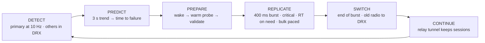
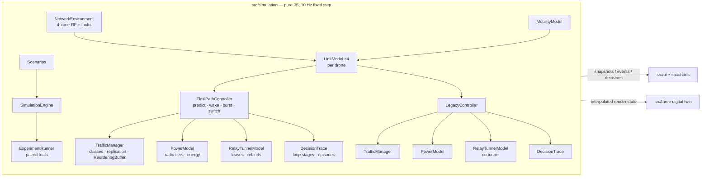

# FlexiPath — Predictive, Traffic-Aware Connectivity Engine

> **ATRC Advanced Technology Pioneers 2026 — EDGE Challenge**
> *"How might we keep a user's experience unbroken as they move between Wi-Fi, mobile, satellite and wired networks?"*

**Don't wait for failure.** FlexiPath predicts when the current path is degrading, prepares the next path before
it is needed, protects only the traffic that actually needs protection, and switches without breaking sessions.

This repository is a **simulation prototype**: a deterministic network simulation, a Three.js digital twin that runs
FlexiPath side by side with a **legacy break-before-make baseline** under identical conditions, an explainable
decision HUD, controlled experiments, and a Blender pipeline that generates every 3D asset. No real-world
measurements are included; every number below is a *measured simulation result* unless marked as a model parameter.

**The scenario.** Two identical drones fly the same low-altitude corridor on the same mission, for example an
inspection or emergency-response flight whose C2 link (flight commands + telemetry) must never drop. Each starts
plugged into its dock (wired Ethernet), takes off over the city on Wi-Fi, follows a 5G corridor and ends in a rural
zone covered only by LEO satellite. On the way it relays the ground team's push-to-talk voice and uploads HD camera
video and survey data. One drone runs FlexiPath, the other the legacy stack, under the same seeded radio field and
faults.

**Phase 2** answers the three engineering objections a multipath design usually meets: **battery drain** (a
three-tier radio sleep model), **packet reordering** (sequence-numbered replication, a TCP head-of-line model and
delay-compensated pacing) and **carrier middleboxes / IP changes** (a userspace UDP tunnel to a static anchor relay).
Each is modelled in the simulation, measured per run and shown in the HUD.

**Existing mechanisms.** FlexiPath is also compared with two existing seamless-connectivity designs:

- **Reactive multipath**: MPTCP with a backup subflow (RFC 8684), or 3GPP ATSSS active-standby.
- **Always duplicate**: the MPTCP redundant scheduler, or 3GPP PDCP duplication.

Both are modelled as baselines and run on the same seeds as FlexiPath and Legacy. The analysis of the references is in
[docs/existing-mechanisms.md](docs/existing-mechanisms.md), and the evidence-based guidelines in
[docs/qos-qoe-guidelines.md](docs/qos-qoe-guidelines.md).

---

## What the demo shows

The site opens on a **landing page** that explains the solution (the problem, the decision loop, the six ideas, the results against existing mechanisms, the guidelines and the real-life plan). **Launch the simulator** opens `simulator.html` on the **Mission view**, kept to the story. The HUD is light (white panels) around the night-time 3D twin. The 3D twin takes most of the screen, with one short column beside it. The header and toolbar are one line each; the decision loop is a one-line stepper where only the active stage shows its text. Fault injection, reset, Experiments and "Why FlexiPath?" are icon buttons with tooltips. The beam legend sits behind a button in the playback bar.

| Area | What it answers |
| --- | --- |
| **Decision loop** — DETECT → PREDICT → PREPARE → REPLICATE → SWITCH → CONTINUE | Which stage the controller is in right now, when it reached each stage, which stages were skipped (e.g. an abrupt outage cannot be predicted), and the radio state each stage runs at (DRX standby, warm probe, burst). |
| **3D twin** | A moonlit night over a real city and desert (press `L` for the original neon digital twin). Two drones on the same corridor; the camera keeps both in frame and an edge marker points to the other drone if it falls out of view. The legacy drone's label shows the distance it has lost. Sleeping modems draw no probe beams (a faint blink marks each DRX signal sample); a warm modem shows dashed heartbeat beams; both beams pulse purple during the burst. |
| **Why did FlexiPath do that?** | The latest decision as a short card — headline, action and reason, beside the rule the legacy stack follows. **Show details** opens the full record (current path, status, alternate, traffic, **radio power tier**) and the decision history. |
| **At a glance** | Which traffic is protected right now (critical, voice, bulk), and FlexiPath vs Legacy on radio power, the longest data stall and client IP changes seen by remote services. **Details** opens the Advanced view. |
| **Legacy vs FlexiPath** | One line of headline numbers. **Show steps** opens both drones' latest transition step by step, timed relative to the moment the path *actually* failed, with the simulated interruption, critical packets lost and failures acted on before they happened. |

The header carries the status, the `SIMULATION` badge, the static **anchor relay** address and the clock.

The **Advanced view** (`M`) keeps the same one-line chrome and holds every panel in one column beside the twin. Tabs
pick one group at a time, and the page remembers the choice:

| Tab | Panels |
| --- | --- |
| **Decision** | The full decision record and its history |
| **Prediction** | Prediction · live (trend, time to failure, next path with its radio state, signal sparkline) and prediction internals (every trigger with its live value and threshold, including the radio wake triggers) |
| **Links** | Interface health (radio power and a radio badge per modem; a modem asleep in DRX shows signal only) |
| **Traffic** | Traffic-aware protection (per flow: class, path, backup, burst or pacing state, overhead) and the flow inspector (sequence numbers, per-flow HoL, pacing offset) |
| **Session** | Battery · ordering · session (radio badges, journey energy, HoL stalls, relay tunnel vs the legacy IP changes) and the relay tunnel (session ID, outer addresses, leases, rebinds) |
| **Controls** · **Log** | Simulation controls, fault injection and exports · the event log |

The **Charts** button opens six 60 s charts under the twin: throughput, latency, loss, MOS, **radio power** and **bulk
HoL stall**. They record the whole run while hidden. **Guided demo** (`D`) replays scenario A and captions each real
decision as it happens; **Experiments** (`X`) runs paired trials and shows the existing-mechanisms comparison on the
same runs.

## Measured results (simulation)

`npm run benchmark` runs scenarios A–F, 5 seeds × 4 speeds (30/60/90/120 km/h): 20 paired runs per scenario. In each run
FlexiPath and Legacy fly together on the same seed, route, RF field and fault timing, and by default the two
existing-mechanism baselines fly alongside them. Values are means over the 20 pairs. The baselines have their own random
streams, so the FlexiPath and Legacy values below are identical with or without them (`--baselines none`).

**Continuity**

| Scenario | Simulated interruption (s) LG / FP | Critical packets delivered (%) LG / FP | Voice MOS LG / FP | FP replication overhead: protected / all bytes | Action vs. path failure (s) LG / FP |
| --- | --- | --- | --- | --- | --- |
| A · Wi-Fi → 5G | 3.80 / 0.00 | 84.9 / 99.0 | 3.71 / 4.30 | 1.11 % / 0.005 % | +1.43 / −3.38 |
| B · Wi-Fi → 5G → LEO | 7.52 / 0.00 | 84.1 / 98.6 | 3.66 / 4.25 | 1.24 % / 0.007 % | +1.92 / −3.78 |
| C · 5G degradation → LEO | 3.73 / 0.00 | 82.8 / 98.2 | 3.59 / 4.22 | 1.36 % / 0.009 % | +2.27 / −4.60 |
| D · Multiple degradation | 16.37 / 0.16 | 77.3 / 98.2 | 3.38 / 4.19 | 0.90 % / 0.006 % | +1.00 / −1.25 |
| E · Critical traffic only | 3.80 / 0.00 | 84.9 / 99.0 | 3.71 / 4.30 | 1.11 % / 1.11 % | +1.43 / −3.38 |
| F · Bulk traffic only | 3.80 / 0.00 | — (no packet flows) | — (no voice) | 0 % / 0 % | +1.43 / −3.38 |

**Battery · ordering · session (Phase 2)**

| Scenario | Mean radio power (W) LG / FP | Radio energy per journey (J) LG / FP | FP burst time (s) | Late duplicates discarded (FP) | Bulk HoL mean (ms) LG / FP | Bulk HoL peak (ms) LG / FP | TCP timeout stalls LG / FP | Client IP changes seen remotely LG / FP |
| --- | --- | --- | --- | --- | --- | --- | --- | --- |
| A | 1.216 / 1.315 | 42.8 / 39.0 | 0.40 | 43 | 7.6 / 1.2 | 390 / 102 | 15.0 / 0.5 | 1.00 / 0 |
| B | 1.216 / 1.315 | 88.1 / 81.7 | 0.84 | 102 | 7.8 / 2.5 | 411 / 133 | 27.4 / 0.6 | 1.95 / 0 |
| C | 1.217 / 1.316 | 43.4 / 40.8 | 0.40 | 54 | 8.3 / 3.2 | 394 / 65 | 12.3 / 0.0 | 0.95 / 0 |
| D | 1.221 / 1.254 | 113.6 / 90.7 | 1.00 | 111 | 6.4 / 3.9 | 421 / 257 | 25.8 / 2.2 | 5.20 / 0 |
| E | 1.216 / 1.315 | 42.8 / 39.0 | 0.40 | 43 | — (no bulk) | — | — | 1.00 / 0 |
| F | 1.221 / 1.315 | 36.3 / 39.0 | 0.40 | 0 | 9.1 / 1.1 | 390 / 102 | 15.0 / 0.5 | 1.00 / 0 |

How to read it:

- **Interruption** is the time every flow was cut off. Each legacy break lasts a model-defined time (3.8 s, see below),
  so this row measures how *often* each stack breaks the session. FlexiPath's 0.16 s in D is an abrupt cell outage that
  no trend predicted: 60 ms detection + 100 ms to wake the sleeping fallback modem from DRX.
- **Action vs. path failure** compares when each stack acted with the instant the path it was leaving actually failed
  (EWMA of the true loss > 15 % or link down). Negative = acted before the failure.
- **Overhead** is replicated bytes / original bytes. Replication is confined to the ~400 ms handoff burst, so it costs
  ≈ 1 % of protected-flow bytes (Phase 1 replicated for the whole risk window: 6–13 %). E (only protected traffic)
  shows the cost side; F shows that bulk traffic is never duplicated.
- **Radio power**: FlexiPath draws ≈ 8 % more radio power on average than the single-radio legacy stack (1.32 vs
  1.22 W in A–C) — the price of warm-probing the next modem (1.8 W) and of the 400 ms dual-radio burst (3.4 W). Keeping
  both radios on all the time would cost 3.4 W. **Radio energy per journey** is lower for FlexiPath in A–E only because
  the legacy drone stops and hovers (fail-safe) and arrives later; in F (no C2 telemetry, so no hover and identical
  journey times) FlexiPath uses 7 % more energy (39.0 vs 36.3 J). Both are reported.
- **Head-of-line**: the critical / real-time HoL stall is **0 ms in every run** — the receiver delivers the first copy
  of each sequence number and discards the late duplicate. Bulk HoL comes from the TCP model: a loss that fast
  retransmit cannot repair stalls the legacy stream for a retransmission timeout (200–500 ms); FlexiPath's bulk stays on
  a healthy path and is paced across the burst.
- **IP changes**: remote services only ever see FlexiPath's anchor relay; the legacy stack's source address changes at
  every reattach, and each change resets its TCP sessions (4 sockets per break).
- The CSV export adds per-metric standard deviations and the 95 % confidence interval of each paired difference.

### Comparison with existing mechanisms

Same benchmark and runs. The analysis and the full tables, with 95 % confidence intervals, are in
[docs/existing-mechanisms.md](docs/existing-mechanisms.md).

Each cell reads **Legacy · Reactive multipath · Always duplicate · FlexiPath**:
- **Reactive multipath**: MPTCP backup subflow / ATSSS active-standby.
- **Always duplicate**: redundant scheduler / PDCP duplication.

| Scenario | Interruption (s) | Critical delivered (%) | Voice MOS | Duplicate bytes, protected flows (%) | Mean radio power (W) |
| --- | --- | --- | --- | --- | --- |
| A · Wi-Fi → 5G | 3.80 · 0.00 · 0.00 · 0.00 | 84.9 · 98.3 · 100.0 · 99.0 | 3.71 · 4.23 · 4.38 · 4.30 | 0 · 0 · 99.7 · 1.1 | 1.22 · 1.20 · 3.39 · 1.31 |
| B · Wi-Fi → 5G → LEO | 7.52 · 0.00 · 0.00 · 0.00 | 84.1 · 97.8 · 99.5 · 98.6 | 3.66 · 4.16 · 4.33 · 4.25 | 0 · 0 · 73.4 · 1.2 | 1.22 · 1.20 · 3.13 · 1.31 |
| C · 5G degradation → LEO | 3.73 · 0.00 · 0.00 · 0.00 | 82.8 · 97.5 · 99.3 · 98.2 | 3.59 · 4.12 · 4.30 · 4.22 | 0 · 0 · 64.5 · 1.4 | 1.22 · 1.20 · 2.85 · 1.32 |
| D · Multiple degradation | 16.37 · 0.68 · 0.00 · 0.16 | 77.3 · 97.0 · 99.0 · 98.2 | 3.38 · 4.10 · 4.27 · 4.19 | 0 · 0 · 49.0 · 0.9 | 1.22 · 1.20 · 2.65 · 1.25 |
| E · Critical traffic only | 3.80 · 0.00 · 0.00 · 0.00 | 84.9 · 98.3 · 100.0 · 99.0 | 3.71 · 4.23 · 4.38 · 4.30 | 0 · 0 · 99.7 · 1.1 | 1.22 · 1.20 · 3.39 · 1.31 |
| F · Bulk traffic only | 3.80 · 0.00 · 0.00 · 0.00 | — | — | 0 · 0 · 0 · 0 | 1.22 · 1.20 · 1.20 · 1.31 |

- **Anchoring removes the interruption.** Every anchored stack removes the legacy interruption, all TCP resets and all
  remote-visible IP changes in the predictable handovers.
- **Prediction plus the burst add the remaining reliability.** Against reactive multipath, FlexiPath:
  - loses 25–40 % fewer critical packets (+0.6 to +1.2 pp delivery; 95 % CIs exclude zero);
  - raises MOS by 0.07–0.10;
  - halves the unpredictable outage's gap in D (0.16 vs 0.35 s, inside the 300 ms fail-safe budget);
  - acts 1.3–4.6 s before the failure instead of 0.3–0.5 s after.

  The cost is about 0.1 W (≈ 9 %) more radio power.
- **Permanent duplication is the most reliable but the most expensive.** It delivers 99–100 % of critical packets, but
  draws 2.65–3.39 W (2.1–2.6× FlexiPath) and duplicates 49–100 % of protected bytes, against FlexiPath's ~1 %.

### Guidelines for QoS / QoE

The full guidelines, each with its evidence, are in [docs/qos-qoe-guidelines.md](docs/qos-qoe-guidelines.md):

1. Anchor the session, not the interface.
2. Act on the trend, not on the failure.
3. Prepare the next path just in time, and only then (spare radios in DRX).
4. Duplicate only what needs it, only around the handover.
5. Deliver the first copy; never make real-time traffic wait in order.
6. Detect a dead path faster than the application can tolerate (detection + wake < deadline).
7. Hold still unless moving clearly pays (hysteresis and dwell).
8. Measure what users feel, on matched pairs.

---

## How FlexiPath decides



| Stage | Rule in the controller (`FlexiPathController.js`) | Model parameters |
| --- | --- | --- |
| Detect | The primary carries all traffic and is measured at 10 Hz (EWMA of loss, RTT, throughput, signal; the controller never sees the true channel). Every other modem sleeps in 3GPP DRX and reports its signal once per DRX cycle — no RTT or loss, so its score is an estimate. | 10 Hz, α ≈ 0.3, DRX cycle 1.28 s |
| Predict | Early warning: a 3 s regression of the primary's signal projects the 15 %-loss level within 8 s (only within 20 dB of it), or a loss / RTT trigger is already true. | horizon 8 s, margin 20 dB, release 1 s |
| Prepare | A secondary is woken when degradation is predicted, the primary's loss rises > 2 % in 1 s, or its health score (critical utility as % of nominal) falls to ≤ 75. After 0.1 s wake-up it sends 64-byte heartbeats every 100 ms; after 0.3 s of heartbeats with loss ≤ 12 % and the best critical score it is the validated next path. | wake 0.1 s, validate 0.3 s, back to DRX after 2 s without a reason |
| Replicate | Act when ΔLoss > 3 %/s, loss > 5 %, RTT drift, time-to-failure (1 s trend, within 10 dB, confirmed 2 ticks) < 3 s, a rapid fade (< −12 dB/s) or dock release — and the validated path beats the primary's predicted score or failure is imminent. Both radios then transmit for the handoff burst. If failure is imminent and the woken modem is not yet validated, it is used anyway (shown as an emergency). | TTF < 3.0 s, burst 400 ms |
| Switch | At the end of the burst the validated path becomes primary and the old radio returns to DRX; 3 s hold-down. Upgrades to a much better path need 1.5× the score, 20 dB inside coverage and 1.5 s of dwell. | 400 ms, 1.5×, 20 dB |
| Continue | Flows ride the relay tunnel to the anchor relay `198.51.100.24`, so no socket is reset; abrupt outages are caught by 3 missed probes (+ a DRX wake if the fallback was asleep). | 60 ms (+ 100 ms) |

Link utility: `W = T^a / (RTT^b · (1 + 12·L²))` — critical `a = 0.4, b = 1.2`, bulk `a = 1.5, b = 0.5`.

### Traffic classes and selective replication

| Class | Flows | Protection | Why |
| --- | --- | --- | --- |
| **CRITICAL** (P1) | C2 link (flight commands + telemetry) | Replicated on both paths during the ~400 ms handoff burst | Loss- and latency-sensitive; small (≈ 0.3 Mbit/s) |
| **REAL-TIME** (P2) | Push-to-talk voice (G.711, 20 ms) | Joins the burst only once its measured loss exceeds 2 % or failure is < 1 s away | Packet-loss concealment hides ≤ 2 % loss (< 0.2 MOS); copying earlier is overhead |
| **BULK** (P3+) | HD camera uplink, survey imagery / map sync | Never replicated: carried on the primary (one radio awake) and moved to the next path within the burst with delay-compensated pacing | A copy would add tens of Mbit/s; reliable transport recovers bulk losses |

Every packet of a critical or real-time flow carries a 32-bit sequence number. The receiver delivers the first copy
and discards the late duplicate, so replication never adds head-of-line delay. Overhead is counted per byte:
`replicated bytes / original packet-flow bytes` and `replicated bytes / all bytes`.

### Explainable decisions

Each important decision produces a record (`decision.records`, exported in the JSON): `ATTACH`, `PREDICT`, `PREPARE`,
`PROTECT`, `PROTECT_RT`, `UPGRADE`, `SWITCH`, `FAILOVER`, `NO_PATH`. A record holds the current path and its measured
status, the alternate with its score (marked as an estimate while that modem sleeps), the traffic treatment, the radio
power tier the decision puts the system in, the action and the reason with the thresholds it crossed. Example action:
*"5G modem primed to Warm Probe state (1.8 W): 64-byte heartbeats validate it; replicate critical traffic in a 400 ms
burst if time-to-failure < 3.0 s"*. The predictor computes no confidence score, so none is shown.

### The legacy baseline

Stock OS behaviour: static metric order `eth0 > wlan0 > wwan0 > sat0`, sticky until a hard floor (Wi-Fi **−85 dBm**,
5G RSRP −122 dBm), then break-before-make:

| Phase (model parameter) | Wireless | Wired undock |
| --- | --- | --- |
| Link-loss detection (beacon miss / RLF timer) | 1.0 s | 0.2 s |
| Scan + attach fallback | 0.8 s | — |
| DHCP lease + route rewrite | 0.5 s | 0.3 s |
| TCP RST → SYN · TLS 1.3 · app re-auth | 1.5 s | 1.5 s |
| **Simulated interruption** | **3.8 s** | **2.0 s** |

A preferred interface coming back (e.g. Wi-Fi after a fade) triggers a voluntary switch-back with a 1.8 s interruption.
With the default fail-safe policy, a drone whose C2 telemetry is silent for > 300 ms stops and hovers in place
(simulated lost-link policy). The legacy stack uses one radio at a time (the others idle in DRX, the scan / attach
phase counts as a second awake radio), binds its sockets to its physical address and runs single-path TCP.

---

## Phase 2 — battery, ordering and carrier transparency

### Battery drain: three-tier radio sleep model (`PowerModel.js`)

| Tier | System draw (model parameter) | When |
| --- | --- | --- |
| 0 · DRX standby | 1.2 W | One radio carries the traffic; every other modem sleeps in 3GPP DRX while the primary's health is > 75. A sleeping modem wakes once per 1.28 s DRX cycle to sample signal only. |
| 1 · Warm probing | 1.8 W | One secondary is awake: woken by a predicted degradation, a > 2 % rise of the primary's loss within 1 s, or primary health ≤ 75. It sends 64-byte heartbeats every 100 ms. |
| 2 · Burst replication | 3.4 W | Both radios transmit — only during the ~400 ms handoff window. |

Power is integrated per tick into energy (J) for each drone until it completes its route. The HUD shows the live
watts and tier, each interface's radio state, journey energy, mean power, time per tier, bursts, wakes and heartbeat
bytes.

### Packet reordering and head-of-line blocking (`ReorderingBuffer.js`)

- **Critical / real-time** — `SequenceReorderBuffer`: 32-bit sequence numbers with RFC 1982 serial arithmetic and a
  4096-sequence duplicate window. First arrival delivered, late duplicate discarded, so the HoL stall is 0 ms by
  construction. As a counterfactual, the buffer also measures how long strict in-order delivery *would* have waited.
- **Bulk (legacy and FlexiPath)** — `TcpHolModel`: a single TCP stream per flow with an RFC 6298 RTT estimator and a
  Mathis-model congestion window (`1.22 / √p`, capped by the bandwidth-delay product). A lost segment is repaired by
  fast retransmit (≈ 1 RTT stall) when the window can produce 3 duplicate ACKs, otherwise by a retransmission timeout
  `max(200 ms, SRTT + 4·RTTVAR)` with at most one back-off — a 200–500 ms stall of the whole byte stream. The mean
  delay added to a byte is `Σ stall² / (2·T)`.
- **Delay-compensated pacing** — while bulk spans two paths during a burst, segments on the slower path are sent ahead
  by the one-way delay difference (ΔRTT / 2); the residual misalignment is the paths' jitter.

### Carrier middleboxes and IP changes (`RelayTunnelModel.js`)

FlexiPath carries every flow in a **userspace UDP tunnel** (48-byte header: IPv6 + UDP + session ID) to an **anchor
relay** at `198.51.100.24:443`. Each interface gets its own address from its network — dock LAN DHCP, Wi-Fi private
DHCP (e.g. `192.168.1.104`), 5G carrier CGNAT (e.g. `100.84.12.9`), LEO operator CGNAT — with a new lease on every
reattach, and carrier NATs rebind the outer port after 30 s idle. The relay re-learns the outer address from the
tunnel packets themselves, so a path change or NAT rebinding is a `REBIND` event and remote services keep seeing the
relay's static address: no TCP reset. UDP encapsulation also passes middleboxes that drop unknown transport protocols.
The legacy stack's sockets are bound to its physical address, so every reattach is a remote-visible source IP change
(`SRC_IP`) and resets its TCP sessions.

---

### Scenarios

| | Scenario | Route X | Faults | Traffic |
| --- | --- | --- | --- | --- |
| · | Full mission (default live view) | 1.5 → 240 | manual | mixed |
| A | Wi-Fi → 5G | 40 → 135 | — | mixed |
| B | Wi-Fi → 5G → LEO | 40 → 240 | — | mixed |
| C | 5G degradation → LEO | 140 → 240 | — | mixed |
| D | Multiple network degradation | 12 → 240 | Wi-Fi fade at X = 30, 5G cell outage at X = 130 | mixed |
| E | Critical traffic during handover | as A | — | critical + real-time |
| F | Bulk traffic during handover | as A | — | bulk only |

The original benchmark matrix (`baseline`, `wifi-fade`, `cell-outage`) is still available to the CLI and the
experiment panel. Scenarios are defined once in `src/simulation/Scenarios.js` and used by the live twin and the batch
runner alike.

---

## Quick start

```bash
npm install
npm run dev          # landing page http://localhost:5173 · simulator http://localhost:5173/simulator.html
```

| Command | What it does |
| --- | --- |
| `npm run dev` | Vite dev server with the full HUD |
| `npm run build` / `npm run preview` | Production bundle in `dist/` |
| `npm run benchmark` | Paired experiments → `results/benchmark_*.json`, per-run `.csv`, `_comparison.csv` and `_mechanisms.csv` (`--quick`, `--seeds 10`, `--speeds 60`, `--scenarios A,D`, `--no-failsafe`, `--baselines mptcp,redundant` or `none`) |
| `npm run models` | Regenerate the six GLB assets with headless Blender (`blender` on `PATH`) |

Simulator URL parameters (on `simulator.html`; a link to the site root that carries any of them is forwarded to the
simulator): `?scenario=A&seed=2026&speed=90&mode=advanced&focus=legacy&camera=overview&paused=1`, `intro=0` skips
the intro screen, `demo=1` starts the guided demo, `models=procedural` forces the built-in primitive models, `look=twin` starts in the neon digital-twin look.

Keys: `Space` pause · `M` mission / advanced · `D` guided demo · `X` experiments · `I` why FlexiPath? · `F` Wi-Fi fade ·
`G` 5G outage · `R` reset · `1`/`2` focus · `C` camera · `V` ghost drone · `T` theatre · `L` real / twin look · `E` export JSON.

### Exports

- **Run JSON** — meta (scenario, seed, data source, anchor relay), model parameters (incl. power, HoL and relay
  parameters), per-engine summary, decision records, episodes, event log and the 10 Hz time series.
- **Run CSV** — one row per tick with both engines side by side (`fp_*`, `lg_*`), including loop stage, primary,
  replica, prepared path, replication flags, cumulative overhead, radio power (W), tier, energy (J), per-interface radio
  states, client and remote-visible IPs, HoL stall, in-order wait and duplicates discarded.
- **Experiments** — per-run rows (mean / peak power in W, energy in J, burst and warm time, duplicates discarded,
  critical and bulk HoL latency, TCP timeout stalls, physical and remote-visible IP changes, tunnel and NAT rebinds,
  next to every continuity metric) and the paired comparison (means, SDs, mean difference, 95 % CI, pairs).

---

## Data provenance and claims

| Label | Meaning |
| --- | --- |
| `MODEL PARAMETER` | Set in the model: thresholds, link capacities, RF constants, legacy recovery phases, radio tier draws (1.2 / 1.8 / 3.4 W), DRX cycle and wake latency, TCP timer bounds, NAT idle timeout, addresses. |
| `MEASURED · SIM` | Measured from simulated runs: interruptions, delivery, MOS, overhead, action-vs-failure times, energy and mean power, HoL stalls, duplicates discarded, IP changes. |
| `REAL-WORLD MEASUREMENT` | None. This is a simulation prototype. |

The HUD labels interruptions as *simulated*, shows a `SIMULATION` badge, and reports differences without a score or
"winner". FlexiPath does not claim zero loss, universal handover or real satellite performance: packets are still lost
(≈ 1–2 % of critical packets in the runs above), an abrupt outage still costs a detection gap (plus a DRX wake), the
radio power is higher than a single-radio stack's, and the RF, satellite and power models are stylised.

---

## Architecture



The simulation never imports the renderer, and the HUD holds no simulation state of its own: the loop stages,
decision records, episodes, radio states, HoL statistics and tunnel addresses are computed in the engine and read from
its snapshots. The same engine drives the 60 fps twin and the headless experiments in Node.

## 3D assets (Blender)

`blender/generate_all_models.py` models, materials and exports all six assets with `bpy` + `bmesh`:

| File | Asset |
| --- | --- |
| `flexipath_drone.glb` | X-frame quadcopter: carbon hull, glowing cyan canopy and prop guards, camera gimbal, multi-link antenna (`AntennaAnchor`), `Rotor_*` pivots |
| `legacy_drone.glb` | the same airframe in crimson / burgundy |
| `wired_node.glb` | pedestal dock terminal, emissive slate terminal ring, `BeamAnchor` |
| `wifi_node.glb` | utility pole with dual-antenna Wi-Fi 6 box (neon cyan) |
| `5g_tower.glb` | hexagonal lattice tower, three down-tilted panel antennas (emerald) |
| `leo_satellite.glb` | CubeSat: gold-foil core, PV wings, downward transponder dish (amber) |

```bash
blender -b -P blender/generate_all_models.py                        # → public/models/
blender -b -P blender/generate_all_models.py -- --out D:/models     # custom output
blender -b -P blender/generate_all_models.py -- --showcase          # also lay them out in a scene
```

Through **Blender MCP** (or the Text Editor) in a running session:

```python
import runpy
runpy.run_path(r"<repo>/blender/generate_all_models.py", run_name="__main__")
```

Each asset is built in its own temporary scene and removed after export. If a GLB is missing, an equivalent procedural
model is built from Three.js primitives, so the twin never fails on assets. Tested with Blender 5.2 LTS.

In the twin, the drones wait on their dock pads, climb out on departure and fly the corridor at a fixed height (about
25 m); the height is visual only (see *Modelling notes and limitations*). A ring on the ground under each drone
carries its state colour (cyan, purple during the burst, red during an interruption) and a faint line joins it to the
drone.

**Two looks** (`L`, the **Real / Twin** button, or `?look=twin`). Both show the same network layer: drones, beams,
packets, coverage rings and labels. The world around it changes.
- **Real** (default) is a moonlit night (`RealWorld.js`):
  - a city on the twin's plots (`RealCity.js`):
    - glass towers with reflective curtain walls, podiums, setbacks, LED crowns and spires;
    - office slabs with ribbon windows;
    - sand-coloured residential blocks with balconies;
    - lit shopfronts along the street;
    - low-rise blocks on the camera side;
  - windows lit floor by floor, with dim night lighting behind the rest so every facade shows its grid;
  - a tarmac road with lane markings, pavements, street lights and palms through zones 1–3;
  - ground that turns to desert sand in zone 4, with dunes, the ridge that shadows 5G, date palms and rocks;
  - road-sign gantries at the zone borders, and a concrete dock apron with painted landing pads.

  The network gear is drawn in steel, with its glow cut to status-light level. The drones are painted like
  enterprise drones, each with LED lights under its motors:
  - FlexiPath: white with cyan accents;
  - Legacy: graphite with red.
- **Twin** is the original neon digital twin: grid floor, wireframe city, neon zone gates and neon drones.

Everything in both looks is built procedurally in code, with no image files.

Colours: Wi-Fi `#00F0FF` · 5G `#10B981` · LEO `#F59E0B` · wired `#64748B` · replication `#A855F7` · failure `#EF4444` ·
healthy `#22C55E`.

## Project structure

```
FlexiPath/
├── index.html                          landing page (static; its numbers are copied from the tables above)
├── simulator.html · package.json · vite.config.js
├── blender/generate_all_models.py      procedural asset generator (headless or MCP)
├── docs/                               existing mechanisms (references + comparison) · QoS / QoE guidelines
├── public/models/                      generated GLBs + manifest.json
├── public/landing/                     simulator screenshots for the landing page (WebP, 1200 / 2400 px)
├── scripts/benchmark.js                Node CLI for paired experiments
└── src/
    ├── main.js · styles.css            simulator entry point, Tailwind v4 theme + light HUD components
    ├── landing/                        landing.js · landing.css (the landing page)
    ├── simulation/                     SimulationEngine, Scenarios, NetworkEnvironment, LinkModel, MobilityModel,
    │                                   TrafficManager, FlexiPathController, LegacyController, MultipathController
    │                                   (existing-mechanism baselines), DecisionTrace,
    │                                   PowerModel, ReorderingBuffer, RelayTunnelModel, QoEModel, ExperimentRunner
    ├── three/                          SceneManager, VehicleManager, NetworkNodeManager, BeamManager,
    │                                   PacketParticleManager, EnvironmentManager, RealWorld + RealCity (realistic look)
    ├── ui/                             Dashboard, SystemLoop, PredictionPanel, DecisionPanel, TrafficPanel,
    │                                   EngineeringPanel, ComparisonLanes, PredictionInternals, TunnelPanel,
    │                                   ExperimentPanel, GuidedDemo, InfoContent, TelemetryPanel, FlowInspector,
    │                                   EventLog, Controls, format
    ├── charts/                         BaseTimeSeriesChart + Throughput / RTT / PacketLoss / QoE / Power / HoL charts
    └── utils/                          Metrics (EWMA, trends), Random (Mulberry32), Export (CSV/JSON)
```

Stack: Vite 8 · Three.js r186 · Chart.js 4 · Tailwind CSS 4 · Lucide.

## Modelling notes and limitations

- **Simulation only.** RF is a calibrated stylised model (path loss + correlated shadowing + AR(1) fast fading), not
  ray-traced; LEO SNR and RTT come from a two-satellite elevation model, not a real constellation.
- Both drones are evaluated on the corridor centre-line, so their large-scale channels are identical; each has its own
  fast-fading and probe-noise streams.
- Legacy recovery durations are model parameters, so interruption totals scale with the number of legacy breaks.
- Packet fate is Bernoulli per packet for critical and real-time flows; bulk flows are fluid (water-filled goodput).
- The "failure" instant used for action-vs-failure times is a definition (EWMA of true loss > 15 % or link down),
  applied identically to both engines.
- Prediction is a linear trend extrapolation. It cannot foresee abrupt outages (scenario D shows the resulting
  failover gap) and it can release a prediction when a trend reverses — both are shown, not hidden.
- **Power** is three system-level tiers of the radio subsystem (assumptions for an onboard multi-modem radio unit, not
  measurements; propulsion is not modelled): no per-bit transmit-power scaling, no per-technology difference between
  Wi-Fi and cellular modems, no RRC tail states beyond the tiers. A DRX modem's score is estimated from its signal with
  the same PHY curves as the link model, without fading.
- **Head-of-line**: critical and real-time flows are packet-level; bulk TCP is an analytical per-tick model (loss
  repair by fast retransmit or RTO), not a packet-level TCP implementation.
- **Tunnel**: the relay is assumed close to the drone's networks (no extra relay latency); addresses are illustrative
  (`198.51.100.0/24` is RFC 5737 documentation space, `100.64.0.0/10` is RFC 6598 CGNAT space).
- **Drone altitude**: the drones fly a low-altitude corridor above the route, and the radio model is the ground-level
  model evaluated on the corridor centre-line; altitude effects (cell antennas tilted down, line-of-sight interference
  from many cells, air-to-ground fading) are not modelled. The altitude shown in the 3D twin is visual only.
- Everything is deterministic per seed: the same seed and inputs reproduce the same run.

## License

Private prototype — no license granted yet (`"license": "UNLICENSED"`). Choose one before publishing.
