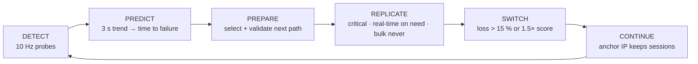
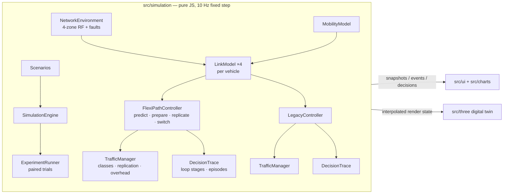

# FlexiPath — Predictive, Traffic-Aware Connectivity Engine

> **ATRC Advanced Technology Pioneers 2026 — EDGE Challenge**
> *"How might we keep a user's experience unbroken as they move between Wi-Fi, mobile, satellite and wired networks?"*

**Don't wait for failure.** FlexiPath predicts when the current path is degrading, prepares the next path before
it is needed, protects only the traffic that actually needs protection, and switches without breaking sessions.

This repository is a **simulation prototype**: a deterministic network simulation, a Three.js digital twin that runs
FlexiPath side by side with a **legacy break-before-make baseline** under identical conditions, an explainable
decision HUD, controlled experiments, and a Blender pipeline that generates every 3D asset. No real-world
measurements are included; every number below is a *measured simulation result* unless marked as a model parameter.

---

## What the demo shows

Open the app and you get the **Mission view**:

| Area | What it answers |
| --- | --- |
| **Decision loop** — DETECT → PREDICT → PREPARE → REPLICATE → SWITCH → CONTINUE | Which stage the controller is in right now, when it reached each stage, and which stages were skipped (e.g. an abrupt outage cannot be predicted). |
| **Prediction · live** | Is the current path degrading? Current link, 3 s signal trend, projected time to the failure level, next path, action — plus a sparkline of the measured signal with the trend extrapolated to the 15 %-loss level. |
| **Why did FlexiPath do that?** | Every decision as a record: current path, status, alternate, traffic, action, reason — built from the values measured when the decision was taken. Shown next to the static rule the legacy stack follows. |
| **Traffic-aware protection** | Which traffic needs protection: class, priority, path, backup path, replication state and its reason, QoE sensitivity, and the measured replication overhead. |
| **Legacy vs FlexiPath** | Both vehicles' latest transition step by step, timed relative to the moment the path *actually* failed, with the simulated interruption, critical packets lost, failures acted on before they happened, and the distance gap. |
| **3D twin** | Two vehicles on the same route; the camera keeps both in frame and an edge marker points to the other vehicle if it falls out of view. |

The **Advanced view** (`M`) keeps the full engineering HUD: interface health, prediction internals (every trigger with
its live value and threshold), flow inspector, controls, event log and four 60 s charts. **Guided demo** (`D`)
replays scenario A and captions each real decision as it happens; **Experiments** (`X`) runs paired trials.

## Measured results (simulation)

`npm run benchmark` — scenarios A–F, 5 seeds × 4 speeds (30/60/90/120 km/h), 20 paired runs per scenario. In each run
FlexiPath and Legacy drive together on the same seed, route, RF field and fault timing.

| Scenario | Simulated interruption (s) LG / FP | Critical packets delivered (%) LG / FP | Voice MOS LG / FP | FP replication overhead: protected / all bytes | Action vs. path failure (s) LG / FP |
| --- | --- | --- | --- | --- | --- |
| A · Wi-Fi → 5G | 3.80 / 0.00 | 84.9 / 99.1 | 3.71 / 4.29 | 9.1 % / 0.030 % | +1.43 / −3.19 |
| B · Wi-Fi → 5G → LEO | 7.52 / 0.00 | 84.1 / 98.8 | 3.66 / 4.26 | 10.2 % / 0.047 % | +1.91 / −3.70 |
| C · 5G degradation → LEO | 3.73 / 0.00 | 82.8 / 98.6 | 3.59 / 4.25 | 12.6 % / 0.086 % | +2.28 / −4.61 |
| D · Multiple degradation | 16.37 / 0.06 | 77.3 / 98.5 | 3.38 / 4.21 | 5.6 % / 0.030 % | +1.00 / −1.58 |
| E · Critical traffic only | 3.80 / 0.00 | 84.9 / 99.1 | 3.71 / 4.29 | 9.1 % / 9.08 % | +1.43 / −3.19 |
| F · Bulk traffic only | 3.80 / 0.00 | — (no packet flows) | — (no voice) | 0 % / 0 % | +1.43 / −3.19 |

How to read it:

- **Interruption** is the time every flow was cut off. Each legacy break lasts a model-defined time (3.8 s, see below),
  so this row measures how *often* each stack breaks the session. FlexiPath's 0.06 s in D is the 60 ms detection gap of
  an abrupt cell outage that no trend predicted.
- **Action vs. path failure** compares when each stack acted with the instant the path it was leaving actually failed
  (EWMA of the true loss > 15 % or link down). Negative = acted before the failure.
- **Overhead** is replicated bytes / original bytes. E (only protected traffic) shows the cost side of replication;
  F shows that bulk traffic is never duplicated.
- The CSV export adds per-metric standard deviations and the 95 % confidence interval of each paired difference.

---

## How FlexiPath decides



| Stage | Rule in the controller (`FlexiPathController.js`) | Model parameters |
| --- | --- | --- |
| Detect | EWMA of measured loss, RTT, throughput and signal on every link; the controller never sees the true channel. | 10 Hz, α ≈ 0.3 |
| Predict | Early warning: a 3 s regression of the primary's signal projects the 15 %-loss level within 8 s (only within 20 dB of it), or a loss / RTT trigger is already true. | horizon 8 s, margin 20 dB, release 1 s |
| Prepare | Best alternate by critical score with loss ≤ 12 % and up ≥ 0.3 s, kept selected and re-validated every tick. | — |
| Replicate | Act when ΔLoss > 3 %/s, loss > 5 %, RTT drift, time-to-failure (1 s trend, within 10 dB, confirmed 2 ticks) < 3 s, a rapid fade (< −12 dB/s) or dock release — and the prepared path beats the primary's predicted score or failure is imminent. | TTF < 3.0 s |
| Switch | Primary loss > 15 % or prepared path scores > 1.5× the primary, confirmed over 2 ticks; 3 s hold-down. | 15 %, 1.5× |
| Continue | Sessions ride the persistent anchor IP `198.51.100.24`; abrupt outages are caught by 3 missed probes. | 60 ms |

Link utility: `W = T^a / (RTT^b · (1 + 12·L²))` — critical `a = 0.4, b = 1.2`, bulk `a = 1.5, b = 0.5`.

### Traffic classes and selective replication

| Class | Flows | Protection | Why |
| --- | --- | --- | --- |
| **CRITICAL** (P1) | EMS telemetry (ECG + CAN) | Replicated for the whole risk window once degradation is predicted | Loss- and latency-sensitive; small (≈ 0.3 Mbit/s) |
| **REAL-TIME** (P2) | VoIP (G.711, 20 ms) | Replicated in a risk window only once its measured loss exceeds 2 % or failure is < 1 s away | Packet-loss concealment hides ≤ 2 % loss (< 0.2 MOS); copying earlier is overhead |
| **BULK** (P3+) | HD video uplink, OTA / map file sync | Never replicated: striped across links by bulk score and drained off a failing link | A copy would add tens of Mbit/s; reliable transport recovers bulk losses |

The receiver keeps the first copy of a replicated packet and discards duplicates. Overhead is counted per byte:
`replicated bytes / original packet-flow bytes` and `replicated bytes / all bytes`.

### Explainable decisions

Each important decision produces a record (`decision.records`, exported in the JSON): `ATTACH`, `PREDICT`, `PREPARE`,
`PROTECT`, `PROTECT_RT`, `UPGRADE`, `RETARGET`, `SWITCH`, `FAILOVER`, `STAND_DOWN`, `NO_PATH`. A record holds the current
path and its measured status, the alternate with its score, the traffic treatment, the action and the reason with the
thresholds it crossed. The predictor computes no confidence score, so none is shown.

### The legacy baseline

Stock OS behaviour: static metric order `eth0 > wlan0 > wwan0 > sat0`, sticky until a hard floor (Wi-Fi **−85 dBm**,
5G RSRP −122 dBm), then break-before-make:

| Phase (model parameter) | Wireless | Wired undock |
| --- | --- | --- |
| Link-loss detection (beacon miss / RLF timer) | 1.0 s | 0.2 s |
| Scan + attach fallback | 0.8 s | — |
| DHCP lease + route rewrite | 0.5 s | 0.3 s |
| TCP RST → SYN · TLS 1.3 · app re-auth | 1.5 s | 1.5 s |
| **Simulated interruption** | **3.8 s** | **2.0 s** |

A preferred interface coming back (e.g. Wi-Fi after a fade) triggers a voluntary switch-back with a 1.8 s interruption.
With the default fail-safe policy, a vehicle whose critical telemetry is silent for > 300 ms brakes to a stop.

### Scenarios

| | Scenario | Route X | Faults | Traffic |
| --- | --- | --- | --- | --- |
| · | Full mission (default live view) | 1.5 → 240 | manual | mixed |
| A | Wi-Fi → 5G | 40 → 135 | — | mixed |
| B | Wi-Fi → 5G → LEO | 40 → 240 | — | mixed |
| C | 5G degradation → LEO | 140 → 240 | — | mixed |
| D | Multiple network degradation | 12 → 240 | Wi-Fi fade at X = 30, 5G cell outage at X = 130 | mixed |
| E | Critical traffic during handover | as A | — | critical + real-time |
| F | Bulk traffic during handover | as A | — | bulk only |

The original benchmark matrix (`baseline`, `wifi-fade`, `cell-outage`) is still available to the CLI and the
experiment panel. Scenarios are defined once in `src/simulation/Scenarios.js` and used by the live twin and the batch
runner alike.

---

## Quick start

```bash
npm install
npm run dev          # http://localhost:5173
```

| Command | What it does |
| --- | --- |
| `npm run dev` | Vite dev server with the full HUD |
| `npm run build` / `npm run preview` | Production bundle in `dist/` |
| `npm run benchmark` | Paired experiments → `results/benchmark_*.json`, per-run `.csv` and `_comparison.csv` (`--quick`, `--seeds 10`, `--speeds 60`, `--scenarios A,D`, `--no-failsafe`) |
| `npm run models` | Regenerate the six GLB assets with headless Blender (`blender` on `PATH`) |

URL parameters: `?scenario=A&seed=2026&speed=90&mode=advanced&focus=legacy&camera=overview&paused=1`, `intro=0` skips
the intro screen, `demo=1` starts the guided demo, `models=procedural` forces the built-in primitive models.

Keys: `Space` pause · `M` mission / advanced · `D` guided demo · `X` experiments · `I` why FlexiPath? · `F` Wi-Fi fade ·
`G` 5G outage · `R` reset · `1`/`2` focus · `C` camera · `V` ghost vehicle · `T` theatre · `E` export JSON.

### Exports

- **Run JSON** — meta (scenario, seed, data source), model parameters, per-engine summary, decision records, episodes,
  event log and the 10 Hz time series.
- **Run CSV** — one row per tick with both engines side by side (`fp_*`, `lg_*`), including loop stage, primary,
  replica, prepared path, replication flags and cumulative overhead.
- **Experiments** — per-run rows and the paired comparison (means, SDs, mean difference, 95 % CI, pairs).

---

## Data provenance and claims

| Label | Meaning |
| --- | --- |
| `MODEL PARAMETER` | Set in the model: thresholds, link capacities, RF constants, legacy recovery phases. |
| `MEASURED · SIM` | Measured from simulated runs: interruptions, delivery, MOS, overhead, action-vs-failure times. |
| `REAL-WORLD MEASUREMENT` | None. This is a simulation prototype. |

The HUD labels interruptions as *simulated*, shows a `SIMULATION` badge, and reports differences without a score or
"winner". FlexiPath does not claim zero loss, universal handover or real satellite performance: packets are still lost
(≈ 1 % of critical packets in the runs above), an abrupt outage still costs a detection gap, and the RF and satellite
models are stylised.

---

## Architecture



The simulation never imports the renderer, and the HUD holds no simulation state of its own: the loop stages,
decision records and episodes are computed in the engine and read from its snapshots. The same engine drives the
60 fps twin and the headless experiments in Node.

## 3D assets (Blender)

`blender/generate_all_models.py` models, materials and exports all six assets with `bpy` + `bmesh`:

| File | Asset |
| --- | --- |
| `flexipath_vehicle.glb` | low-poly cyber-vehicle, carbon chassis, glowing cyan cabin, `AntennaAnchor`, `Wheel_*` pivots |
| `legacy_vehicle.glb` | the same chassis in crimson / burgundy |
| `wired_node.glb` | pedestal charging dock, emissive slate terminal ring, `BeamAnchor` |
| `wifi_node.glb` | utility pole with dual-antenna Wi-Fi 6 box (neon cyan) |
| `5g_tower.glb` | hexagonal lattice tower, three down-tilted panel antennas (emerald) |
| `leo_satellite.glb` | CubeSat: gold-foil core, PV wings, downward transponder dish (amber) |

```bash
blender -b -P blender/generate_all_models.py                        # → public/models/
blender -b -P blender/generate_all_models.py -- --out D:/models     # custom output
blender -b -P blender/generate_all_models.py -- --showcase          # also lay them out in a scene
```

Through **Blender MCP** (or the Text Editor) in a running session:

```python
import runpy
runpy.run_path(r"<repo>/blender/generate_all_models.py", run_name="__main__")
```

Each asset is built in its own temporary scene and removed after export. If a GLB is missing, an equivalent procedural
model is built from Three.js primitives, so the twin never fails on assets. Tested with Blender 5.2 LTS.

Colours: Wi-Fi `#00F0FF` · 5G `#10B981` · LEO `#F59E0B` · wired `#64748B` · replication `#A855F7` · failure `#EF4444` ·
healthy `#22C55E`.

## Project structure

```
FlexiPath/
├── index.html · package.json · vite.config.js
├── blender/generate_all_models.py      procedural asset generator (headless or MCP)
├── public/models/                      generated GLBs + manifest.json
├── scripts/benchmark.js                Node CLI for paired experiments
└── src/
    ├── main.js · styles.css            entry point, Tailwind v4 theme + HUD components
    ├── simulation/                     SimulationEngine, Scenarios, NetworkEnvironment, LinkModel, MobilityModel,
    │                                   TrafficManager, FlexiPathController, LegacyController, DecisionTrace,
    │                                   QoEModel, ExperimentRunner
    ├── three/                          SceneManager, VehicleManager, NetworkNodeManager, BeamManager,
    │                                   PacketParticleManager, EnvironmentManager
    ├── ui/                             Dashboard, SystemLoop, PredictionPanel, DecisionPanel, TrafficPanel,
    │                                   ComparisonLanes, PredictionInternals, ExperimentPanel, GuidedDemo,
    │                                   InfoContent, TelemetryPanel, FlowInspector, EventLog, Controls, format
    ├── charts/                         BaseTimeSeriesChart + Throughput / RTT / PacketLoss / QoE charts
    └── utils/                          Metrics (EWMA, trends), Random (Mulberry32), Export (CSV/JSON)
```

Stack: Vite 8 · Three.js r186 · Chart.js 4 · Tailwind CSS 4 · Lucide.

## Modelling notes and limitations

- **Simulation only.** RF is a calibrated stylised model (path loss + correlated shadowing + AR(1) fast fading), not
  ray-traced; LEO SNR and RTT come from a two-satellite elevation model, not a real constellation.
- Both vehicles are evaluated on the road centre-line, so their large-scale channels are identical; each has its own
  fast-fading and probe-noise streams.
- Legacy recovery durations are model parameters, so interruption totals scale with the number of legacy breaks.
- Packet fate is Bernoulli per packet for critical and real-time flows; bulk flows are fluid (water-filled goodput).
- The "failure" instant used for action-vs-failure times is a definition (EWMA of true loss > 15 % or link down),
  applied identically to both engines.
- Prediction is a linear trend extrapolation. It cannot foresee abrupt outages (scenario D shows the resulting
  failover gap) and it can release a prediction when a trend reverses — both are shown, not hidden.
- Everything is deterministic per seed: the same seed and inputs reproduce the same run.

## License

Private prototype — no license granted yet (`"license": "UNLICENSED"`). Choose one before publishing.
