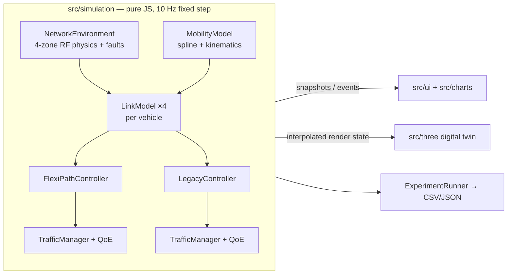

# FlexiPath — Zero-Disruption Heterogeneous Network Mobility

> **ATRC Advanced Technology Pioneers 2026 — EDGE Challenge**
> *"How might we keep a user's experience unbroken as they move between Wi-Fi, mobile, satellite and wired networks?"*

FlexiPath is an adaptive, client-side transport proxy that treats wired, Wi-Fi 6, 5G SA and LEO satellite links **not as
an either/or choice but as one score-weighted pipe**. It probes every link at 10 Hz, predicts a failing link *before* it
drops, mirrors critical packets over two paths during the transition, and hot-swaps the primary route behind a
persistent anchor IP (`198.51.100.24`) — so no socket is ever reset.

This repository is an end-to-end interactive prototype: a deterministic network simulation, a Three.js digital twin
with a side-by-side **legacy OS baseline**, a telemetry HUD, and a Blender pipeline that generates every 3D asset.

| Benchmark (5 seeds × 4 speeds, 30–120 km/h) | FlexiPath | Legacy OS |
| --- | --- | --- |
| Handover stall time — baseline drive | **0.00 s** | 9.55 s |
| Handover stall time — rapid Wi-Fi fade injected | **0.00 s** | 15.15 s |
| Handover stall time — abrupt 5G cell outage injected | **0.06 s** | 13.82 s |
| Critical-flow packet loss (baseline) | **1.04 %** | 14.2 % |
| Mean MOS, ITU-T G.107 (baseline) | **4.28** | 3.74 |
| Time below MOS 3.6 (baseline) | **0.2 s** | 18.0 s |
| TCP connection resets (baseline) | **0** | 12 |
| Journey time with fail-safe braking (baseline) | **80.8 s** | 94.2 s |

Reproduce with `npm run benchmark` (numbers above: default matrix, seeds `1000 + 7919·k`).

---

## Quick start

```bash
npm install
npm run dev          # http://localhost:5173
```

The twin runs immediately. 3D assets load from `public/models/*.glb`; if a file is missing, an equivalent procedural
model is built from Three.js primitives, so the app never fails on assets.

| Command | What it does |
| --- | --- |
| `npm run dev` | Vite dev server with the full HUD |
| `npm run build` / `npm run preview` | Production bundle in `dist/` |
| `npm run benchmark` | Headless batch run → `results/benchmark_*.json` + `.csv` (`--quick`, `--seeds 10`, `--speeds 30,60`, `--scenarios baseline,wifi-fade,cell-outage`, `--no-failsafe`) |
| `npm run models` | Regenerate the six GLB assets with headless Blender (`blender` on `PATH`) |

URL parameters make demos reproducible: `?seed=2026&speed=90&focus=legacy&camera=overview&paused=1`.
Add `models=procedural` to force the built-in primitive models instead of the GLBs.

---

## How it works



The simulation never imports the renderer. The same engine drives the 60 fps twin (with interpolation between ticks)
and the headless benchmark in Node.

### 1 · DETECT
Every interface is sampled at 10 Hz — throughput, RTT, jitter, loss and RSSI/RSRP/SNR — through probe-level noise; the
controller only ever sees *measured* values, while the *true* channel decides packet fate.

| Interface | Nominal | Model |
| --- | --- | --- |
| `eth0` Gigabit dock | 500 Mbps · 3 ms · 0.1 % | carrier present only while docked at the depot |
| `wlan0` Wi-Fi 6 AP | 150 Mbps · 5 ms · 0.5 % | Friis R² + linear clutter loss, peak ≈ −45 dBm |
| `wwan0` 5G SA | 85 Mbps · 22 ms · 1 % | log-distance n = 3.8, urban shadow near the depot, terrain diffraction in zone 4 |
| `sat0` LEO | 35 Mbps · 65 ms · 2 % | SNR/RTT from elevation to the serving satellite of a 2-bird constellation |

Loss follows a link-edge logistic `L = L₀ + (1 − L₀)/(1 + e^{(SNR − SNR₅₀)/k})`, capacity a Shannon-shaped MCS ladder,
RTT grows with retransmissions `RTT₀ + T_retx · L/(1 − L)`.

### 2 · PREDICT
EWMA monitors (α ≈ 0.3) track loss, RTT, throughput and signal over a 10-tick (1.0 s) window:

- `ΔLoss = Loss_latest − Loss_{t−10}` → trigger when **ΔLoss > 0.03** or **Loss > 0.05**
- RTT drift: slope > 25 % of baseline per second while RTT > 1.6 × baseline
- **Time-to-failure**: linear extrapolation of the signal to the level where PER hits 15 %, armed within the last
  10 dB of margin and confirmed over 200 ms (keeps shadow-fading ripples from triggering at speed)
- Rapid-fade detector: signal slope steeper than −12 dB/s
- Context: dock-release while parked on `eth0`

### 3 · PREPARE & REPLICATE
Link utility, normalised to a 0–100 gauge on a log scale:

$$W_i = \frac{\text{Throughput}_i^{\,a}}{\text{RTT}_i^{\,b}\,(1 + \alpha\,\text{LossRate}_i^2)},\qquad \alpha = 12$$

| Profile | a | b | Used for |
| --- | --- | --- | --- |
| General | 1.0 | 1.0 | HUD utility score |
| CRITICAL | 0.4 | 1.2 | primary / replica selection (VoIP, emergency telemetry) |
| BULK | 1.5 | 0.5 | weights for striping bulk flows across links |

When the primary is degrading and a candidate beats the primary's **predicted** score (2 s horizon) — or failure is
imminent — critical packets are mirrored onto both paths. The receiver keeps the first copy and discards duplicates.
Bulk traffic drains off the failing link; LEO capacity is treated as metered and only carries bulk when it is primary.

### 4 · SWITCH & CONTINUE
The route hot-swaps when **primary loss > 15 %** or **W_candidate > 1.5 · W_primary** (confirmed over 2 ticks), then
replication disengages. A 3 s hold-down prevents ping-pong; upgrades back to a better link are also make-before-break.
An *unpredictable* abrupt outage is caught by probe loss in 60 ms (3 × 20 ms) — a blackout, not a session reset.

### 5 · CONTRAST — the legacy baseline
Stock OS behaviour: static metric order `eth0 > wlan0 > wwan0 > sat0`, sticky until a hard floor (Wi-Fi **−85 dBm**,
5G RSRP −122 dBm ≈ radio-link failure), then break-before-make:

| Phase | Wireless | Wired undock |
| --- | --- | --- |
| Link-loss detection (beacon miss / RLF timer) | 1.0 s | 0.2 s |
| Scan + attach fallback | 0.8 s | — |
| DHCP lease + route rewrite | 0.5 s | 0.3 s |
| TCP RST → SYN · TLS 1.3 · app re-auth | 1.5 s | 1.5 s |
| **Socket stall** | **3.8 s** | **2.0 s** |

With the (default-on) teleoperation policy, a vehicle whose critical telemetry is silent for > 300 ms brakes to a
minimal-risk stop — the legacy car visibly stutters to a halt and loses journey time.

### QoE
Running MOS from the ITU-T G.107 E-model on the VoIP flow: `R = 93.2 − I_d − I_e,eff`, G.711 with PLC
(`I_e = 0, B_pl = 25.1`), mouth-to-ear delay = one-way network delay + adaptive jitter buffer + 25 ms codec; a stalled
session scores MOS 1.0.

### Coverage zones (1 scene unit = 5 m, route X = 0 → 240 = 1.2 km)

| Zone | X | What happens |
| --- | --- | --- |
| 1 · Depot / urban Wi-Fi | 0–40 | wired dock releases, Wi-Fi 6 at peak |
| 2 · Handover corridor | 40–90 | Wi-Fi attenuates, 5G rises — prediction & replication fire here |
| 3 · 5G SA core | 90–160 | 5G dominant |
| 4 · Rural dead-zone | 160–240 | 5G fades behind the ridge; LEO takes over |

---

## Using the HUD

- **Left deck** — interface health cards (signal bars, throughput, RTT, loss, jitter, utility score, predicted
  time-to-failure) and the flow inspector (per-flow paths, replication status, duplicates discarded).
- **Viewport** — FlexiPath car vs the crimson legacy ghost; beams per link (blue wired, cyan Wi-Fi, green 5G, gold LEO,
  purple = replication window, red = legacy stall); packets travel at a speed set by link RTT and fizzle red when lost.
- **Right deck** — cumulative handover stall time, engine toggle (FlexiPath Mode / Legacy OS Mode), side-by-side ghost
  toggle, fail-safe policy, speed 0–120 km/h, seed, fault injection, JSON/CSV export and the batch benchmark.
- **Bottom** — 60 s rolling throughput, latency (log), packet loss and MOS, with replication (purple) and stall (red) bands.

Keys: `Space` pause · `1`/`2` focus engine · `F` Wi-Fi fade · `G` 5G outage · `R` reset · `C` camera · `V` ghost ·
`T` theatre mode · `E` export JSON · `?` help.

### Exports
- **JSON** — `meta`, full model parameters, per-engine summary, event log and the 10 Hz time series.
- **CSV** — one row per tick with both engines side by side (`fp_*`, `lg_*`: position, speed, zone, throughput,
  latency, loss, MOS, primary/replica, state, replication/stall flags, RSSI/RSRP/SNR, cumulative stall).
- **Benchmark** — per-run rows plus mean/std/min/max aggregates per scenario × engine.

---

## 3D assets (Blender)

`blender/generate_all_models.py` procedurally models, materials and exports all six assets with `bpy` + `bmesh`:

| File | Asset |
| --- | --- |
| `flexipath_vehicle.glb` | low-poly cyber-vehicle, carbon chassis, glowing cyan cabin, `AntennaAnchor`, `Wheel_*` pivots |
| `legacy_vehicle.glb` | the same chassis in crimson / burgundy |
| `wired_node.glb` | pedestal charging dock, emissive blue terminal ring, `BeamAnchor` |
| `wifi_node.glb` | utility pole with dual-antenna Wi-Fi 6 box (neon cyan) |
| `5g_tower.glb` | hexagonal lattice tower, three down-tilted panel antennas (emerald) |
| `leo_satellite.glb` | CubeSat: gold-foil core, PV wings, downward transponder dish (amber) |

```bash
blender -b -P blender/generate_all_models.py                        # → public/models/
blender -b -P blender/generate_all_models.py -- --out D:/models     # custom output
blender -b -P blender/generate_all_models.py -- --showcase          # also lay them out in a scene
```

Through **Blender MCP** (or the Text Editor) in a running session:

```python
import runpy
runpy.run_path(r"<repo>/blender/generate_all_models.py", run_name="__main__")
```

Each asset is built in its own temporary scene and removed after export, so running it inside an open file never
touches your scenes. Emission uses Principled *Emission Color/Strength* → glTF `emissiveFactor` +
`KHR_materials_emissive_strength`, which the twin feeds into its bloom pass. Tested with Blender 5.2 LTS.

---

## Project structure

```
FlexiPath/
├── index.html · package.json · vite.config.js
├── blender/generate_all_models.py      procedural asset generator (headless or MCP)
├── public/models/                      generated GLBs + manifest.json
├── scripts/benchmark.js                Node CLI for the batch benchmark
└── src/
    ├── main.js · styles.css            entry point, Tailwind v4 theme + HUD components
    ├── simulation/                     SimulationEngine, NetworkEnvironment, LinkModel, MobilityModel,
    │                                   TrafficManager, FlexiPathController, LegacyController, QoEModel,
    │                                   ExperimentRunner
    ├── three/                          SceneManager, VehicleManager, NetworkNodeManager, BeamManager,
    │                                   PacketParticleManager, EnvironmentManager
    ├── ui/                             Dashboard, TelemetryPanel, FlowInspector, EventLog, Controls
    ├── charts/                         BaseTimeSeriesChart + Throughput / RTT / PacketLoss / QoE charts
    └── utils/                          Metrics (EWMA, trends), Random (Mulberry32), Export (CSV/JSON)
```

Stack: Vite 8 · Three.js r186 · Chart.js 4 · Tailwind CSS 4 · Lucide.

## Modelling notes & limitations

- RF is a calibrated stylised model (path loss + correlated shadowing + AR(1) fast fading), not ray-traced; both
  vehicles are evaluated on the road centre-line so their channels are identical — a controlled experiment.
- Scene scale is exaggerated for legibility (vehicles and towers are enlarged relative to the 1.2 km route).
- Packet fate is Bernoulli per packet for critical flows and fluid (water-filled goodput) for bulk flows.
- Everything is deterministic per seed: the same seed and inputs reproduce the same run, bit for bit.

## License

Private prototype — no license granted yet (`"license": "UNLICENSED"`). Choose one before publishing.
