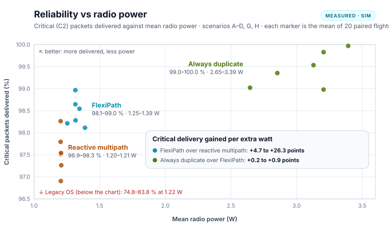
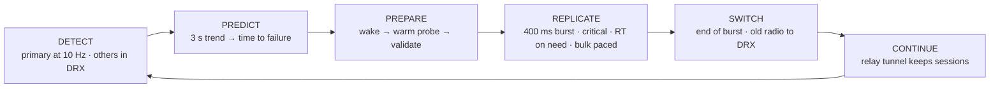
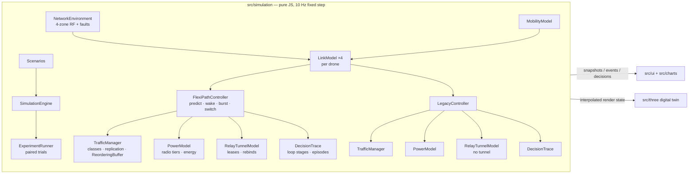

# FlexiPath — Predictive, Traffic-Aware Connectivity Engine

> **ATRC Advanced Technology Pioneers 2026 — EDGE Challenge**
> *"How might we keep a user's experience unbroken as they move between Wi-Fi, mobile, satellite and wired networks?"*

**Don't wait for failure.** FlexiPath predicts when the current path is degrading, prepares the next path before
it is needed, protects only the traffic that actually needs protection, and switches without breaking sessions.

This repository is a **simulation prototype**: a deterministic network simulation, a Three.js digital twin that runs
FlexiPath side by side with a **legacy break-before-make baseline** under identical conditions, an explainable
decision HUD, controlled experiments, and a Blender pipeline that generates every 3D asset. No real-world
measurements are included; every number below is a *measured simulation result* unless marked as a model parameter.
AI tools supported the work; see the [AI-use declaration](#ai-use-declaration).

**The scenario.** Two identical drones fly the same low-altitude corridor on the same mission, for example an
inspection or emergency-response flight whose C2 link (flight commands + telemetry) must never drop. Each starts
plugged into its dock (wired Ethernet), takes off over the city on Wi-Fi, follows a 5G corridor and ends in a rural
zone covered only by LEO satellite. On the way it relays the ground team's push-to-talk voice and uploads HD camera
video and survey data. One drone runs FlexiPath, the other the legacy stack, under the same seeded radio field and
faults.

**Phase 2** answers the three engineering objections a multipath design usually meets: **battery drain** (a
three-tier radio sleep model), **packet reordering** (sequence-numbered replication, a TCP head-of-line model and
delay-compensated pacing) and **carrier middleboxes / IP changes** (a userspace UDP tunnel to a static anchor relay).
Each is modelled in the simulation, measured per run and shown in the HUD.

**Route foresight.** A drone flies a planned route, so FlexiPath also reads a **coverage map** of it: the dead zones
earlier survey flights recorded (an urban canyon, a ridge cut). A trend cannot warn of a shadow whose edge is abrupt,
and where Wi-Fi and 5G die at the same place the usual backup dies too. FlexiPath sees a mapped dead zone 8 s ahead,
wakes and validates a path the map says survives it (the satellite), and moves before the shadow. Scenario G tests
this; scenario H tests what an out-of-date map costs.

**Existing mechanisms.** FlexiPath is also compared with two existing seamless-connectivity designs:

- **Reactive multipath**: MPTCP with a backup subflow (RFC 8684), or 3GPP ATSSS active-standby. It runs twice: with
  its own 250 ms detection of a lost link, and with FlexiPath's 60 ms, so that no result rests on the detection
  constant alone.
- **Always duplicate**: the MPTCP redundant scheduler, or 3GPP PDCP duplication.

They are modelled as baselines and run on the same seeds as FlexiPath and Legacy. The analysis of the references is in
[docs/existing-mechanisms.md](docs/existing-mechanisms.md), and the evidence-based guidelines in
[docs/qos-qoe-guidelines.md](docs/qos-qoe-guidelines.md).

**How the claims are tested.** Besides the baselines, every benchmark flies three **ablations** (FlexiPath with trend
prediction, the duplication burst or the coverage map switched off), reports **prediction precision and recall**, and
is re-run on a **held-out block of seeds** never used while building or tuning FlexiPath; the headline comes from that
block, with confidence intervals that resample whole seeds. The negative results are reported too: in this model the
400 ms burst adds no measurable reliability, FlexiPath gives up 15–28 % throughput in the shadow scenarios G and H,
and a stale map costs throughput.

---

## What the demo shows

The site opens on a **landing page** that explains the solution (the problem, the decision loop, the seven ideas, the results against existing mechanisms, the guidelines and the real-life plan). **Launch the simulator** opens `simulator.html` on the **Mission view**, kept to the story. The HUD is light (white panels) around the night-time 3D twin. The 3D twin takes most of the screen, with one short column beside it. The header and toolbar are one line each; the decision loop is a one-line stepper where only the active stage shows its text. Fault injection, reset, Experiments and "Why FlexiPath?" are icon buttons with tooltips. The beam legend sits behind a button in the playback bar.

| Area | What it answers |
| --- | --- |
| **Decision loop** — DETECT → PREDICT → PREPARE → REPLICATE → SWITCH → CONTINUE | Which stage the controller is in right now, when it reached each stage, which stages were skipped (e.g. an abrupt outage cannot be predicted), and the radio state each stage runs at (DRX standby, warm probe, burst). |
| **3D twin** | A moonlit night over a realistic procedural city and desert (press `L` for the original neon digital twin). Two drones on the same corridor; the camera keeps both in frame and an edge marker points to the other drone if it falls out of view. The legacy drone's label shows the distance it has lost. Sleeping modems draw no probe beams (a faint blink marks each DRX signal sample); a warm modem shows dashed heartbeat beams; both beams pulse purple during the burst. |
| **Why did FlexiPath do that?** | The latest decision as a short card — headline, action and reason, beside the rule the legacy stack follows. **Show details** opens the full record (current path, status, alternate, traffic, **radio power tier**) and the decision history. |
| **At a glance** | Which traffic is protected right now (critical, voice, bulk), and FlexiPath vs Legacy on radio power, the longest data stall and client IP changes seen by remote services. **Details** opens the Advanced view. |
| **Legacy vs FlexiPath** | One line of headline numbers. **Show steps** opens both drones' latest transition step by step, timed relative to the moment the path *actually* failed, with the simulated interruption, critical packets lost and failures acted on before they happened. |

The header carries the status, the `SIMULATION` badge, the static **anchor relay** address and the clock.

The **Advanced view** (`M`) keeps the same one-line chrome and holds every panel in one column beside the twin. Tabs
pick one group at a time, and the page remembers the choice:

| Tab | Panels |
| --- | --- |
| **Decision** | The full decision record and its history |
| **Prediction** | Prediction · live (trend, time to failure, next path with its radio state, signal sparkline) and prediction internals (every trigger with its live value and threshold, including the radio wake triggers) |
| **Links** | Interface health (radio power and a radio badge per modem; a modem asleep in DRX shows signal only) |
| **Traffic** | Traffic-aware protection (per flow: class, path, backup, burst or pacing state, overhead) and the flow inspector (sequence numbers, per-flow HoL, pacing offset) |
| **Session** | Battery · ordering · session (radio badges, journey energy, HoL stalls, relay tunnel vs the legacy IP changes) and the relay tunnel (session ID, outer addresses, leases, rebinds) |
| **Controls** · **Log** | Simulation controls, fault injection and exports · the event log |

The **Charts** button opens six 60 s charts under the twin: throughput, latency, loss, MOS, **radio power** and **bulk
HoL stall**. They record the whole run while hidden. The **guided demo** (`D`, `?demo=1`) flies the full mission
(dock → Wi-Fi → 5G → LEO, three handovers) and pauses the simulation at each real moment — the prediction, the
replication burst, the switch, the legacy interruption and its recovery — with a short caption of what is happening,
built from the decision record and the measured values of that tick, and a ring on the dashboard panel where it
shows. Nothing resumes by itself: from a paused moment, Next steps through the panels that moment changed — the
Mission panels, the Advanced view's tabs or the charts, as the moment needs — one card per panel, placed beside the
ringed panel and reading its live numbers; each panel is explained once, so later stops get shorter; the last card
resumes the flight, back in the Mission view, from where it paused. Hold flight, the play button and Space pause the running flight the same way. When the mission ends, a card
on the scenario picker shows what else there is to fly (the eight scenarios A–H; picking one ends the demo and flies
it with the same two drones), then the result of the mission with buttons for 10 paired trials, a walk through every
dashboard, a replay or free exploration. **Experiments** (`X`) runs paired trials and shows the
existing-mechanisms comparison on the same runs.

## Measured results (simulation)

`npm run benchmark` runs scenarios A–H, 5 seeds × 4 speeds (30/60/90/120 km/h): 20 paired runs per scenario. In each run
FlexiPath and Legacy fly together on the same seed, route, RF field and fault timing, and by default the three
existing-mechanism baselines and the three FlexiPath ablations fly alongside them. Values are means over the 20 pairs.
The baselines have their own random streams and the ablations replay FlexiPath's, so the FlexiPath and Legacy values
below are identical with or without them (`--baselines none --ablations none`).

**Archived data.** The raw CSVs behind every table in this section are committed in
[`results/published/`](results/published/MANIFEST.md): ten runs, each on the development and the held-out seeds: the
default (speed-consistent) hover rule, the 300 ms and the 1 s rule at every speed, the 260 ms modem wake and the 60 ms
reactive RTO. The data was produced at commit `ec5378940279eb494a9e7be1aacd020de39cf276`;
[MANIFEST.md](results/published/MANIFEST.md) gives the date, the exact commands, the seed blocks and SHA-256 sums. To
check a number, check out that commit (or any later one that does not change `src/simulation`) and run the same
command: the runs are deterministic, so the CSVs are byte-identical (`npm run test:full` does this for you). When the
model changes, re-run the commands in the manifest into `results/published/`, put the new commit hash here and in the
manifest, and update the tables.

**Hover rule.** A drone hovers (fail-safe) when its C2 link is silent too long. The benchmark uses a speed-consistent
rule, after 3GPP TS 22.125: **300 ms at ≤ 60 km/h** (stick steering, which the standard specifies up to 60 km/h) and
**1 s above 60 km/h** (waypoint flight). The pure 300 ms rule at every speed is kept as a sensitivity run
(`--failsafe-ms 300`), see [The hover rule](#the-hover-rule-piloted-vs-waypoint-flight).

**Seeds.** The headline and the four-stack comparison use the **held-out seed block** (`--seed-block test`: seeds
`900001 + 7919·i`, never used while FlexiPath was built or tuned). The detail tables (continuity, Phase 2, reliability
per watt, ablation, prediction) use the **development block** (`1000 + 7919·i`, the default), on which FlexiPath was
tuned; [Held-out seeds](#held-out-seeds) compares the two blocks.

**Confidence intervals.** The four speeds of one seed share its RF field and faults, so the seed is the unit of
independence: 5 seeds per block, not 20 independent runs. The 95 % intervals in brackets come from a bootstrap that
resamples whole seeds (seed-clustered); the benchmark writes them to every CSV next to the Student-t interval over runs
(`± …`).

### Headline (held-out seeds)

Pooled over scenarios A–D, G and H (120 paired runs: 5 held-out seeds × 4 speeds × 6 scenarios; E repeats A's C2
numbers and F has no C2), the benchmark's `_headline.csv`:

| FlexiPath against | Critical C2 loss, FlexiPath / baseline | Fewer critical packets lost | Critical delivery | Radio power | Mean throughput | Runs FlexiPath better / worse |
| --- | --- | --- | --- | --- | --- | --- |
| Reactive multipath (250 ms detection) | 1.49 % / 2.40 % | **38 %** [33, 42] | +0.91 pp [+0.77, +1.06] | +0.12 W [+0.11, +0.13] | −5.2 Mbit/s [−5.7, −4.9] | 117 / 3 |
| Reactive multipath, **60 ms detection** (as FlexiPath) | 1.49 % / 2.12 % | **30 %** [25, 35] | +0.63 pp [+0.51, +0.78] | +0.12 W [+0.11, +0.13] | −5.4 Mbit/s [−5.8, −5.0] | 114 / 5 |
| Always duplicate | 1.49 % / 0.60 % | −149 % (loses 2.5× more) | −0.89 pp [−0.98, −0.82] | −1.74 W [−1.76, −1.72] | −5.3 Mbit/s [−5.9, −4.9] | 7 / 112 |

**In words:** on held-out seeds, FlexiPath loses 38 % fewer critical C2 packets than reactive multipath, and 30 % fewer
when the reactive baseline detects a lost link as fast as FlexiPath (60 ms), for about 0.12 W more radio power. It
pays for it with throughput in the shadow scenarios (15–28 % less than reactive multipath in G and H, below). These
numbers assume a spare modem that **wakes in 100 ms** (a fast-resume state). With the measured **260 ms** LTE wake the
reductions grow to 42 % and 36 %, but FlexiPath then hovers on half of the flights in D and H
([Sensitivity](#sensitivity-a-slower-modem-wake)).

On the development seeds the same pooled figures are 37.3 % [33.5, 40.0] against reactive multipath and 29.1 %
[24.9, 32.1] against the 60 ms variant (118 / 2 and 111 / 8 runs).

**Continuity** (development seeds)

| Scenario | Simulated interruption (s) LG / FP | Critical packets delivered (%) LG / FP | Voice MOS LG / FP | FP replication overhead: protected / all bytes | Action vs. path failure (s) LG / FP |
| --- | --- | --- | --- | --- | --- |
| A · Wi-Fi → 5G | 3.80 / 0.00 | 83.8 / 99.0 | 3.67 / 4.30 | 1.20 % / 0.005 % | +1.43 / −3.38 |
| B · Wi-Fi → 5G → LEO | 7.37 / 0.00 | 83.5 / 98.6 | 3.66 / 4.25 | 1.33 % / 0.007 % | +1.94 / −3.78 |
| C · 5G degradation → LEO | 3.63 / 0.00 | 82.4 / 98.3 | 3.60 / 4.22 | 1.46 % / 0.010 % | +2.27 / −4.60 |
| D · Multiple degradation | 16.77 / 0.16 | 74.8 / 98.2 | 3.28 / 4.20 | 0.95 % / 0.006 % | +0.99 / −1.25 |
| E · Critical traffic only | 3.80 / 0.00 | 83.8 / 99.0 | 3.67 / 4.30 | 1.20 % / 1.197 % | +1.43 / −3.38 |
| F · Bulk traffic only | 3.80 / 0.00 | — (no packet flows) | — (no voice) | 0 % / 0 % | +1.43 / −3.38 |
| G · Radio shadow on the route | 6.93 / 0.00 | 79.3 / 98.5 | 3.46 / 4.24 | 2.22 % / 0.012 % | +0.29 / −3.15 |
| H · Coverage map out of date | 7.88 / 0.10 | 76.4 / 98.1 | 3.34 / 4.17 | 3.00 % / 0.019 % | +0.64 / −3.47 |

**Battery · ordering · session (Phase 2)** (development seeds)

| Scenario | Mean radio power (W) LG / FP | Radio energy per journey (J) LG / FP | FP burst time (s) | Late duplicates discarded (FP) | Bulk HoL mean (ms) LG / FP | Bulk HoL peak (ms) LG / FP | TCP timeout stalls LG / FP | Client IP changes seen remotely LG / FP |
| --- | --- | --- | --- | --- | --- | --- | --- | --- |
| A | 1.218 / 1.315 | 41.4 / 38.9 | 0.40 | 42 | 8.0 / 1.2 | 390 / 102 | 14.9 / 0.5 | 1.00 / 0 |
| B | 1.217 / 1.315 | 85.4 / 81.7 | 0.84 | 102 | 8.0 / 2.4 | 420 / 133 | 27.4 / 0.6 | 1.75 / 0 |
| C | 1.218 / 1.316 | 42.1 / 40.8 | 0.40 | 54 | 8.5 / 3.1 | 394 / 65 | 12.2 / 0.0 | 0.80 / 0 |
| D | 1.224 / 1.254 | 109.2 / 90.7 | 1.00 | 111 | 6.9 / 3.9 | 447 / 257 | 25.4 / 2.2 | 5.15 / 0 |
| E | 1.218 / 1.315 | 41.4 / 38.9 | 0.40 | 42 | — (no bulk) | — | — | 1.00 / 0 |
| F | 1.221 / 1.315 | 36.2 / 38.9 | 0.40 | 0 | 9.1 / 1.1 | 390 / 102 | 14.9 / 0.5 | 1.00 / 0 |
| G | 1.218 / 1.346 | 49.6 / 43.7 | 0.80 | 97 | 3.1 / 2.7 | 183 / 93 | 6.5 / 0.2 | 2.35 / 0 |
| H | 1.220 / 1.388 | 51.2 / 44.8 | 1.18 | 133 | 6.6 / 3.7 | 390 / 197 | 12.2 / 0.7 | 2.60 / 0 |

How to read it:

- **Interruption** is the time every flow was cut off. Each legacy break lasts a model-defined time (3.8 s, see below),
  so this row measures how *often* each stack breaks the session. FlexiPath's 0.16 s in D is an abrupt cell outage that
  no trend predicted: 60 ms detection + 100 ms to wake the sleeping fallback modem from DRX. Both are model parameters;
  the 60 ms is an assumed constant, not a simulated probe ([limitations](#modelling-notes-and-limitations)).
- **Action vs. path failure** compares when each stack acted with the instant the path it was leaving actually failed
  (EWMA of the true loss > 15 % or link down). Negative = acted before the failure.
- **Overhead** is replicated bytes / original bytes. Replication is confined to the ~400 ms handoff burst, so it costs
  1.0–1.5 % of protected-flow bytes in A–E and 2.2–3.0 % in G and H (Phase 1 replicated for the whole risk window:
  6–13 %). E (only protected traffic) shows the cost side; F shows that bulk traffic is never duplicated. E matches A in
  every C2 and voice number: in this model the uploads never take capacity from C2 or voice, so removing them changes
  only the bulk and all-traffic figures.
- **Radio power**: FlexiPath draws ≈ 8 % more radio power on average than the single-radio legacy stack (1.32 vs
  1.22 W in A–C) — the price of warm-probing the next modem (1.8 W) and of the 400 ms dual-radio burst (3.4 W). Keeping
  both radios on all the time would cost 3.4 W. **Radio energy per journey** is lower for FlexiPath in A–E only because
  the legacy drone stops and hovers (fail-safe) and arrives later; in F (no C2 telemetry, so no hover and identical
  journey times) FlexiPath uses 7 % more energy (38.9 vs 36.2 J). Both are reported.
- **Head-of-line**: the critical / real-time HoL stall is **0 ms in every run** — the receiver delivers the first copy
  of each sequence number and discards the late duplicate. Bulk HoL comes from the TCP model: a loss that fast
  retransmit cannot repair stalls the legacy stream for a retransmission timeout (200–500 ms); FlexiPath's bulk stays on
  a healthy path and is paced across the burst.
- **IP changes**: remote services only ever see FlexiPath's anchor relay; the legacy stack's source address changes at
  every reattach, and each change resets its TCP sessions (4 sockets per break).
- The CSV export adds per-metric standard deviations, the Student-t 95 % interval of each paired difference and the
  seed-clustered bootstrap interval.

### Comparison with existing mechanisms

Same benchmark, **held-out seeds** (`npm run benchmark -- --seed-block test`), speed-consistent hover rule. The
analysis of the references is in [docs/existing-mechanisms.md](docs/existing-mechanisms.md); its tables predate the
60 ms baseline and the speed-consistent rule (they use the development seeds and the 300 ms rule at every speed).

Each cell reads **Legacy · Reactive multipath · Reactive multipath, 60 ms detection · Always duplicate · FlexiPath**:
- **Reactive multipath**: MPTCP backup subflow / ATSSS active-standby. It leaves a path after 15 % loss for one 250 ms
  retransmission timeout, and notices a dropped link after the same 250 ms.
- **Reactive multipath, 60 ms detection**: the same design, but it notices a dropped link after 60 ms, FlexiPath's
  detection time. It replays the default baseline's random streams, so the difference between the two comes only
  from the detection time.
- **Always duplicate**: redundant scheduler / PDCP duplication.

| Scenario | Flights that kept C2 (%) | Longest gap (s) | Critical delivered (%) | Voice MOS |
| --- | --- | --- | --- | --- |
| A · Wi-Fi → 5G | 0 · 100 · 100 · 100 · 100 | 3.80 · 0.00 · 0.00 · 0.00 · 0.00 | 83.7 · 98.2 · 98.2 · 100.0 · 99.1 | 3.67 · 4.22 · 4.22 · 4.38 · 4.29 |
| B · Wi-Fi → 5G → LEO | 0 · 100 · 100 · 100 · 100 | 3.80 · 0.00 · 0.00 · 0.00 · 0.00 | 83.3 · 97.8 · 97.8 · 99.4 · 98.6 | 3.65 · 4.17 · 4.17 · 4.33 · 4.24 |
| C · 5G degradation → LEO | 0 · 100 · 100 · 100 · 100 | 3.77 · 0.00 · 0.00 · 0.00 · 0.00 | 82.3 · 97.7 · 97.7 · 99.3 · 98.4 | 3.60 · 4.15 · 4.15 · 4.31 · 4.23 |
| D · Multiple degradation | 0 · 50 · 95 · 100 · 100 | 3.80 · 0.35 · 0.16 · 0.00 · 0.16 | 74.7 · 97.0 · 97.5 · 99.0 · 98.2 | 3.28 · 4.09 · 4.13 · 4.27 · 4.19 |
| E · Critical traffic only | 0 · 100 · 100 · 100 · 100 | 3.80 · 0.00 · 0.00 · 0.00 · 0.00 | 83.7 · 98.2 · 98.2 · 100.0 · 99.1 | 3.67 · 4.22 · 4.22 · 4.38 · 4.29 |
| F · Bulk traffic only | — (no C2) | 3.80 · 0.00 · 0.00 · 0.00 · 0.00 | — | — |
| G · Radio shadow on the route | 0 · 50 · 95 · 80 · 100 | 3.80 · 0.35 · 0.16 · 0.24 · 0.00 | 78.7 · 97.6 · 98.1 · 99.0 · 98.6 | 3.44 · 4.17 · 4.20 · 4.29 · 4.23 |
| H · Coverage map out of date | 0 · 50 · 100 · 100 · 100 | 3.80 · 0.35 · 0.16 · 0.00 · 0.10 | 76.7 · 97.2 · 97.8 · 99.8 · 98.2 | 3.36 · 4.13 · 4.16 · 4.36 · 4.15 |

| Scenario | Mean throughput (Mbit/s) | Mean radio power (W) | Radio energy per journey (J) | Duplicate bytes, protected flows (%) |
| --- | --- | --- | --- | --- |
| A · Wi-Fi → 5G | 77.8 · 90.1 · 90.1 · 90.3 · 93.2 | 1.22 · 1.20 · 1.20 · 3.39 · 1.32 | 41.4 · 35.9 · 35.9 · 101.3 · 39.0 | 0 · 0 · 0 · 99.6 · 1.2 |
| B · Wi-Fi → 5G → LEO | 64.4 · 69.6 · 69.6 · 69.8 · 70.7 | 1.22 · 1.20 · 1.20 · 3.11 · 1.30 | 85.8 · 75.4 · 75.4 · 194.8 · 81.1 | 0 · 0 · 0 · 75.8 · 1.3 |
| C · 5G degradation → LEO | 50.6 · 56.0 · 56.0 · 56.0 · 55.9 | 1.22 · 1.20 · 1.20 · 2.83 · 1.30 | 42.4 · 37.7 · 37.7 · 88.1 · 40.4 | 0 · 0 · 0 · 65.8 · 1.4 |
| D · Multiple degradation | 52.5 · 58.0 · 58.3 · 58.1 · 59.1 | 1.22 · 1.20 · 1.20 · 2.64 · 1.27 | 109.3 · 86.2 · 86.1 · 197.1 · 91.5 | 0 · 0 · 0 · 51.4 · 1.0 |
| E · Critical traffic only | 0.3 · 0.4 · 0.4 · 0.4 · 0.4 | 1.22 · 1.20 · 1.20 · 3.39 · 1.32 | 41.4 · 35.9 · 35.9 · 101.3 · 39.0 | 0 · 0 · 0 · 99.6 · 1.2 |
| F · Bulk traffic only | 77.0 · 91.5 · 91.5 · 91.5 · 95.2 | 1.22 · 1.20 · 1.20 · 1.20 · 1.32 | 36.2 · 35.9 · 35.9 · 35.9 · 39.0 | 0 · 0 · 0 · 0 · 0 |
| G · Radio shadow on the route | 68.8 · 82.6 · 82.9 · 82.5 · **70.3** | 1.22 · 1.21 · 1.21 · 3.20 · 1.34 | 50.1 · 39.7 · 39.7 · 105.6 · 43.6 | 0 · 0 · 0 · 92.8 · 2.2 |
| H · Coverage map out of date | 68.1 · 86.3 · 86.5 · 86.3 · **62.0** | 1.22 · 1.21 · 1.21 · 3.20 · 1.38 | 50.4 · 39.7 · 39.7 · 105.7 · 44.8 | 0 · 0 · 0 · 92.8 · 3.1 |

"Kept C2" counts the flights in which the C2 link was never silent long enough to force the fail-safe hover under the
speed-consistent rule (300 ms at ≤ 60 km/h, 1 s above; [The hover rule](#the-hover-rule-piloted-vs-waypoint-flight)).
The 300 ms piloted-flight threshold is our own conservative choice; TS 22.125 defines no hover or lost-link timeout.

- **Anchoring removes the interruption.** Every anchored stack removes the legacy interruption, all TCP resets and all
  remote-visible IP changes in the predictable handovers.
- **Prediction adds reliability, but less than the detection constant suggests.** In A–C no path drops abruptly, so
  both reactive baselines behave the same; there FlexiPath delivers +0.63 to +0.84 pp more critical packets (CIs
  exclude zero) and acts 3.3–3.9 s before the failure. In D, G and H part of the lead came from the faster detection:
  against the 60 ms variant FlexiPath's lead falls from +1.22 to +0.69 pp (D), +1.01 to +0.50 pp (G) and +0.97 to
  +0.35 pp (H). All three still exclude zero on the held-out seeds. The cost is about 0.12 W (≈ 9 %) more radio power
  and 3–6 J (6–13 %) more radio energy per journey than reactive multipath.
- **Kept C2 with and without equal detection.** With its 250 ms detection, reactive multipath (a 0.35 s gap) hovers on
  the 10 flights at ≤ 60 km/h in D, G and H, and FlexiPath on none. With 60 ms detection the gap is 0.16 s, the same
  as FlexiPath's in D, and reactive multipath keeps C2 on 19 of 20 flights in D and G and on 20 of 20 in H. So the
  "kept C2" difference in D and H comes from the detection constant, not from the FlexiPath design. Only G (the
  mapped shadow, 0 s gap) and one flight in D remain.
- **FlexiPath trades throughput for C2 continuity in G and H.** It moves to the slower satellite before the shadow
  (G) or at the remembered canyon (H). Mean throughput: 70.3 vs 82.6 Mbit/s for reactive multipath in G (−15 %), and
  62.0 vs 86.3 Mbit/s in H (−28 %), where it is also below the legacy stack's 68.1 Mbit/s. In A–D it is 0.3 % lower to
  3.5 % higher than reactive multipath.
- **Permanent duplication is the most reliable but the most expensive.** It delivers 99.0–100 % of critical packets, but
  draws 2.64–3.39 W (2.1–2.6× FlexiPath) and duplicates 51–100 % of protected bytes, against FlexiPath's 1–3 %.
- **A shared dead zone defeats the existing designs (G).** Wi-Fi and 5G die at the same place. Reactive multipath
  hovers on 10 of 20 flights (19 of 20 kept with 60 ms detection), and always duplicate, whose two copies die together,
  on 4 of 20. FlexiPath, warned by the coverage map, is on the satellite before the shadow: 0 s gap, C2 kept on all 20
  flights. No baseline receives a map, so G shows the value of route foresight, not a like-for-like contest.
- **An out-of-date map costs, and does not help (H).** FlexiPath moves needlessly at the remembered canyon (25.5 Mbit/s
  less mean throughput than without the map) and meets the new, unmapped shadow with an ordinary failover (0.10 s). It
  still keeps C2, as fast failover does without any map.



On the development seeds FlexiPath sits between the two existing designs. It delivers 0.70–1.31 points more critical
packets than reactive multipath for 0.05–0.18 W more, and 0.44–1.72 points fewer than always duplicate for
2.1–2.6× less power. The chart is drawn from the default benchmark's `_mechanisms.csv` (development seeds) by
`node scripts/tradeoff-chart.js`; it shows the 250 ms reactive baseline. E is left out (its C2 numbers equal A's) and
so is F (no C2 traffic).

**Reliability per extra watt** (development seeds). Divide what a stack gains in critical delivery by the radio power
it adds over its neighbour on the power axis. These are paired means; the benchmark writes them to `_efficiency.csv`.

| Scenario | FlexiPath over reactive multipath | FlexiPath over reactive multipath, 60 ms detection | Always duplicate over FlexiPath |
| --- | --- | --- | --- |
| A | +0.70 pp for +0.11 W = **6.3 pp/W** | +0.70 pp for +0.11 W = **6.3 pp/W** | +1.00 pp for +2.08 W = **0.5 pp/W** |
| B | +0.85 pp for +0.11 W = **7.6 pp/W** | +0.85 pp for +0.11 W = **7.6 pp/W** | +0.89 pp for +1.81 W = **0.5 pp/W** |
| C | +0.77 pp for +0.11 W = **6.7 pp/W** | +0.77 pp for +0.11 W = **6.7 pp/W** | +1.07 pp for +1.54 W = **0.7 pp/W** |
| D | +1.31 pp for +0.05 W = **26.3 pp/W** | +0.79 pp for +0.05 W = **15.8 pp/W** | +0.81 pp for +1.39 W = **0.6 pp/W** |
| G | +1.00 pp for +0.14 W = **7.1 pp/W** | +0.40 pp for +0.14 W = **2.8 pp/W** | +0.44 pp for +1.86 W = **0.2 pp/W** |
| H | +0.85 pp for +0.18 W = **4.7 pp/W** | +0.29 pp for +0.18 W = **1.6 pp/W** | +1.72 pp for +1.82 W = **0.9 pp/W** |

Spent the FlexiPath way, an extra watt buys 4.7–7.6 points of critical delivery over the 250 ms baseline (26.3 in D,
because there FlexiPath draws only 0.05 W more), and 1.6–7.6 points over the 60 ms baseline (15.8 in D). Spent on
permanent duplication, the same watt buys 0.2–0.9 points. A ratio is only as certain as its two differences; their
intervals are in the `_mechanisms.csv`.

### The hover rule: piloted vs waypoint flight

"Kept C2" depends on how long a drone tolerates C2 silence before it hovers. 3GPP TS 22.125 (§7.2, Table 7.2-1, "KPIs
for command and control of UAV operation") sets the requirement per control mode:

| Control mode (3GPP TS 22.125) | C2 message interval | End-to-end latency | Max ground speed | Hover rule used here |
| --- | --- | --- | --- | --- |
| Direct stick steering (piloted, with video) | 40 ms | 40 ms | 60 km/h | 300 ms at ≤ 60 km/h (default): about 7 missed commands, so more lenient than the standard |
| Steer to waypoints | ≥ 1 s | 1 s | 300 km/h | 1 s above 60 km/h (default); at every speed with `--failsafe-ms 1000` |

The default rule is speed-consistent: the 90 and 120 km/h runs are above the stick-steering speed limit, so they use
the waypoint rule. `--failsafe-ms 300` applies the piloted rule at every speed (a sensitivity run, stricter than the
standard's scope), and `--failsafe-ms 1000` the waypoint rule at every speed.

Flights that kept C2 (%), **Legacy · Reactive multipath · Reactive multipath 60 ms · Always duplicate · FlexiPath**,
held-out seeds (development seeds in brackets where they differ):

| Scenario | Speed-consistent rule (default) | 300 ms at every speed (sensitivity) | 1 s at every speed |
| --- | --- | --- | --- |
| A, B, C, E | 0 · 100 · 100 · 100 · 100 | 0 · 100 · 100 · 100 · 100 | 0 · 100 · 100 · 100 · 100 |
| D · Multiple degradation | 0 · 50 · 95 · 100 · 100 | 0 · 0 · 95 (90) · 100 · 100 | 0 · 100 · 100 · 100 · 100 |
| G · Radio shadow on the route | 0 · 50 · 95 · 80 (90) · 100 | 0 · 0 · 95 · 30 (40) · 100 | 0 · 100 · 100 · 100 · 100 |
| H · Coverage map out of date | 0 · 50 · 100 · 100 · 100 | 0 · 0 · 100 · 100 · 100 | 0 · 100 · 100 · 100 · 100 |

- **Speed-consistent rule:** FlexiPath keeps C2 on every flight of every scenario — **with a spare modem that wakes in
  100 ms**; with the measured 260 ms wake it hovers on half of the flights in D and H ([Sensitivity](#sensitivity-a-slower-modem-wake)).
  Reactive multipath's 0.35 s gap (a 250 ms detection plus a 100 ms modem wake) makes it hover on the 10 flights at
  ≤ 60 km/h in D, G and H. With 60 ms detection it keeps C2 on 19–20 of 20 flights there. Always duplicate hovers on 4
  of 20 flights in G (2 of 20 on the development seeds).
- **300 ms at every speed:** the earlier headline rule. Reactive multipath then hovers on every flight of D, G and H,
  and always duplicate on 14 of 20 in G (12 of 20 on the development seeds). The 60 ms variant still keeps C2 on 19–20
  of 20 (18 of 20 in D on the development seeds). This row overstates the baselines' losses, because 90 and 120 km/h
  are outside the stick-steering scope.
- **1 s at every speed:** every multipath stack keeps C2 everywhere; only the legacy stack's 3.6–3.8 s breaks force a
  hover.
- **The standard is stricter than all three rules.** Its 40 ms stick-steering budget would also catch FlexiPath's 0.16 s
  gap in the abrupt outages of D and H. Only always duplicate rides through an unpredictable outage without a gap, at
  2.1–2.6× the power. The standard also asks for 99.9 % C2 reliability within the latency; in this model, which never
  retransmits a lost C2 datagram, only always duplicate comes close (99.0–100 %).
- The hover rule changes the multipath stacks' delivery and power only a little: on the development seeds, pooled over
  A–D, G and H, FlexiPath's critical-loss reduction against reactive multipath is 37 % under the speed-consistent rule
  and 35 % under the 300 ms rule at every speed (30 % and 28 % against the 60 ms variant on the held-out seeds).

### Ablation: what each part contributes

Development seeds. The same runs fly FlexiPath three more times with one part switched off. The ablations replay
FlexiPath's own random streams (common random numbers), so the radio conditions are identical and any difference
comes from the part that was switched off. Each cell is the change in critical packets lost per flight when the part
is off (mean over the 20 pairs, seed-clustered 95 % CI in brackets; + = worse without it).

| Scenario | No trend prediction | No 400 ms burst | No coverage map |
| --- | --- | --- | --- |
| A · Wi-Fi → 5G | +9.6 [+6.9, +13.3] | −2.8 [−5.4, −0.3] | identical (nothing on the map) |
| B · Wi-Fi → 5G → LEO | +30.1 [+22.7, +36.4] | −1.6 [−2.4, −0.7] | identical |
| C · 5G → LEO | +16.9 [+11.8, +22.1] | +0.5 [−0.4, +1.4] | identical |
| D · Multiple faults | +19.1 [+11.8, +26.6] | −0.7 [−7.7, +6.0] | identical |
| E · Critical only | +9.6 [+6.9, +13.3] | −2.8 [−5.4, −0.3] | identical |
| G · Radio shadow | −0.1 [−0.1, 0.0] | −0.1 [−1.6, +1.4] | +14.2 [+12.2, +16.9], and a 0.20 s gap; 1 flight hovers |
| H · Stale map | +2.6 [0.0, +6.2] | +3.2 [−0.9, +6.3] | −15.5 [−20.6, −10.2] (the stale map hurts) |

- **Trend prediction does the work in A–E.** Without it FlexiPath reacts to measured trouble only: it acts on 13–40 %
  of the failures before they happen instead of 62–100 %, loses 0.15–0.48 pp more critical packets and 0.02–0.05 MOS,
  and draws slightly *more* power (+0.004 to +0.040 W), because it reacts later and less cleanly.
- **The coverage map does the work in G** (0.20 s → 0 s gap, 14 fewer critical packets lost, +0.07 MOS) at 9.0 Mbit/s
  of throughput, and costs 24.5 Mbit/s for nothing when it is out of date (H).
- **The 400 ms burst adds no measurable reliability in this model** (critical delivery within ±0.11 pp in A–E) and costs
  0.02–0.04 W. In A, B and E its point estimate is slightly harmful (1.6–2.8 more packets lost with it). The model has
  no switch-over transient on the new path (route convergence, NAT binding, a congestion window restarting), which is
  what the burst insures against; it is kept as insurance for a transient the model does not include, and the claim is
  made no stronger than that.

### Prediction quality

Development seeds, pooled over all 20 runs of a scenario. **Recall** = path failures FlexiPath acted on before they
happened / all path failures (abrupt ones included). **Precision** = early moves that a real failure of the path
followed (within 12 s) / all early moves. **Lead** = mean time from the action to the failure.

| Scenario | Recall | Recall without trend | Recall without map | Precision | Lead |
| --- | --- | --- | --- | --- | --- |
| A | 100 % | 40 % | 100 % | 100 % | 3.4 s |
| B | 100 % | 25 % | 100 % | 98 % | 3.8 s |
| C | 100 % | 35 % | 100 % | 100 % | 4.6 s |
| D | 62 % | 13 % | 62 % | 97 % | 1.2 s |
| E | 100 % | 40 % | 100 % | 100 % | 3.4 s |
| F | 100 % | 40 % | 100 % | 100 % | 3.4 s |
| G | 100 % | 100 % | 0 % | 100 % | 3.2 s |
| H | 45 % | 44 % | 50 % | 70 % | 3.5 s |

D's recall is 62 % because each flight has one abrupt cell outage that nothing predicts; FlexiPath acts early on 34 of
the 35 predictable failures. In H the stale map's needless move lowers precision to 70 %.

### Held-out seeds

The headline and the four-stack comparison above use the held-out block (`npm run benchmark -- --seed-block test`:
seeds `900001 + 7919·i`, never used while building or tuning FlexiPath). The detail tables use the development block
(`1000 + 7919·i`). The conclusions are the same on both. Paired differences in critical delivery (pp), with the
seed-clustered 95 % CI:

| Scenario | FlexiPath − reactive multipath · dev → test | FlexiPath − reactive multipath 60 ms · dev → test | FlexiPath − always duplicate · dev → test | Flights FlexiPath kept C2 · dev → test |
| --- | --- | --- | --- | --- |
| A | +0.70 [0.58, 0.85] → +0.84 [0.58, 1.16] | same as reactive multipath | −1.00 [−1.14, −0.86] → −0.88 [−1.01, −0.78] | 100 % → 100 % |
| B | +0.85 [0.69, 1.01] → +0.79 [0.63, 0.95] | same | −0.89 [−1.04, −0.70] → −0.79 [−0.85, −0.73] | 100 % → 100 % |
| C | +0.77 [0.59, 0.94] → +0.63 [0.39, 0.85] | same | −1.07 [−1.15, −1.01] → −0.90 [−1.16, −0.64] | 100 % → 100 % |
| D | +1.31 [1.20, 1.42] → +1.22 [1.15, 1.32] | +0.79 [0.72, 0.89] → +0.69 [0.60, 0.78] | −0.81 [−0.94, −0.68] → −0.80 [−0.83, −0.76] | 100 % → 100 % |
| G | +1.00 [0.80, 1.15] → +1.01 [0.79, 1.27] | +0.40 [0.20, 0.55] → +0.50 [0.33, 0.70] | −0.44 [−0.66, −0.26] → −0.32 [−0.51, −0.11] | 100 % → 100 % |
| H | +0.85 [0.67, 1.00] → +0.97 [0.72, 1.23] | +0.29 [0.11, 0.41] → +0.35 [0.10, 0.60] | −1.72 [−2.01, −1.48] → −1.65 [−1.76, −1.56] | 100 % → 100 % |

In A–C no path drops abruptly, so the two reactive baselines are identical there. The ablation and prediction
results also carry over (trend prediction: +11 to +25 lost packets per flight when off in A–E; map: 0.18 s gap and 16
more lost packets when off in G; recall 100 % in A–C, 64 % in D, 47 % in H; precision 100 % in D, 75 % in H). Five
seeds per block is a small number of independent units; the seed-clustered intervals are wide for that reason, and
more seeds per block would narrow them.

### Checked against published measurements

The challenge welcomes real-world measurements but does not require them. Instead of one laptop test, the model's key
parameters are compared here with published measurements, Linux defaults and 3GPP requirements. The last column says
which way the model leans. Where it leans towards one stack, the benchmark was re-run with the other value (next
sections).

| What | In the model | Published real-world value | Source | Which way the model leans |
| --- | --- | --- | --- | --- |
| Wi-Fi loss detection (legacy) | 1.0 s | Linux declares a beacon loss after 7 missed beacons (≈ 0.72 s at the usual 102.4 ms interval), then waits 500 ms per probe of the access point before it disconnects | [Linux mac80211][linux-mlme] | Shorter than Linux: generous to the legacy stack |
| Wi-Fi scan + re-association | 0.8 s (scan and attach to the fallback network) | 399.8 ms on average for one card, access point to access point, link layer only; scanning is over 90 % of it | [Mishra et al., 2003][mishra] | Same order; the measured figure leaves out DHCP and the IP layer |
| TCP retransmission timeout (how reactive multipath notices loss) | 250 ms | Linux minimum 200 ms; RFC 6298 recommends at least 1 s | [Linux `tcp.h`][linux-tcp], [RFC 6298][rfc6298] | Between the two |
| Abrupt link loss detection (FlexiPath) | 60 ms, an assumed constant ("3 missed probes"); the simulation has no 20 ms probe, its tick and heartbeat are 100 ms | — | — | Towards FlexiPath against the 250 ms baseline: hence the 60 ms reactive baseline above, and `--rto-ms 60` below |
| Cell-to-cell handover | Not modelled | 76 ms (LTE), 110 ms (5G standalone), 167 ms (5G non-standalone) on average, on US commercial networks; data stops for 59 % of a non-standalone handover | [Hassan et al., SIGCOMM 2022][hassan] | Real flights add ≈ 0.1 s handovers for every stack. FlexiPath's 0.16 s abrupt-outage gap is the size of one such handover |
| Waking a sleeping modem | 100 ms | 260 ms for an LTE phone leaving RRC_IDLE (2012); 3GPP's 5G target from a battery-saving state is 10 ms | [Huang et al., MobiSys 2012][huang], [3GPP TR 38.913 §7.4][tr38913] | Optimistic for an idle LTE modem: re-run with 260 ms below |
| Modem sleep cycle | 1.28 s | 1.28 s (LTE RRC_IDLE DRX cycle) | [Huang et al., 2012][huang] | Matches |
| Cellular radio power | 1.2 W one radio · 1.8 W warm probe · 3.4 W burst (system draw) | 1.06 W (LTE tail), 1.21 W (promotion), up to 3.3 W (fast uplink) | [Huang et al., 2012][huang] | Same order |
| LEO round trip | 65 ms base | Starlink median ≈ 40–50 ms (M-Lab speed tests); ≈ 40 ms from the dish to Starlink's point of presence (RIPE Atlas) | [Mohan et al., WWW 2024][mohan] | Slower than Starlink: conservative for any stack on the satellite |
| LEO path stability | Steady | Network-wide reconfiguration every 15 s, with brief sub-second disruptions | [Mohan et al., 2024][mohan] | Not modelled: real time on the satellite is bumpier |
| LEO terminal power | The same three tiers as the other modems | Starlink Mini: 20–40 W on average, 15 W idle | [Starlink Help Centre][starlink-mini] | Not modelled: time on (or warm on) the satellite costs far more power in reality |
| C2 timing | Hover after 300 ms at ≤ 60 km/h (piloted), 1 s above (waypoints) | 40 ms per command (stick steering, ≤ 60 km/h); 1 s (waypoints, ≤ 300 km/h) | [3GPP TS 22.125 §7.2][ts22125] | See [The hover rule](#the-hover-rule-piloted-vs-waypoint-flight) |

### Sensitivity: a slower modem wake

`npm run benchmark -- --seed-block test --wake-ms 260` re-runs the benchmark with the measured LTE wake for every
multipath stack (260 ms instead of 100 ms). The legacy stack has no sleeping spare, so its numbers do not change.
Held-out seeds, speed-consistent hover rule:

| Scenario | Kept C2: 100 → 260 ms wake (LG · MP · MP 60 ms · RD · FP, %) | Longest gap, FP / MP / MP 60 ms (s): 100 → 260 ms | FlexiPath − reactive multipath, critical delivery (pp): 100 → 260 ms | FlexiPath − reactive multipath 60 ms (pp): 100 → 260 ms |
| --- | --- | --- | --- | --- |
| A | unchanged: 0 · 100 · 100 · 100 · 100 | 0 / 0 / 0 → 0 / 0 / 0 | +0.84 → +1.11 | same as MP |
| B | unchanged: 0 · 100 · 100 · 100 · 100 | 0 / 0 / 0 → 0 / 0 / 0 | +0.79 → +1.03 | same as MP |
| C | unchanged: 0 · 100 · 100 · 100 · 100 | 0 / 0 / 0 → 0 / 0 / 0 | +0.63 → +0.85 | same as MP |
| D | 0 · 50 · 95 · 100 · 100 → 0 · 50 · 50 · 100 · **50** | 0.16 / 0.35 / 0.16 → 0.32 / 0.51 / 0.32 | +1.22 → +1.52 | +0.69 → +0.95 |
| G | 0 · 50 · 95 · 80 · 100 → 0 · 50 · 50 · 75 · 100 | 0 / 0.35 / 0.16 → 0 / 0.51 / 0.32 | +1.01 → +1.50 | +0.50 → +0.92 |
| H | 0 · 50 · 100 · 100 · 100 → 0 · 50 · 50 · 100 · **50** | 0.10 / 0.35 / 0.16 → 0.27 / 0.51 / 0.32 | +0.97 → +1.08 | +0.35 → +0.48 |

- **Predicted failures do not pay the wake.** In A–C and G FlexiPath wakes the next modem seconds before it needs it,
  so nothing changes for it. The reactive baselines pay the full wake on every move: their gaps grow by 0.16 s, and
  FlexiPath's delivery lead grows. Pooled over A–D, G and H, FlexiPath then loses 42 % [38, 46] fewer critical packets
  than reactive multipath and 35.5 % [30.5, 40.2] fewer than the 60 ms variant.
- **Unpredicted failures do.** D's cell outage and H's unmapped shadow cost FlexiPath detection plus the wake, 0.27–0.32
  s. Under the speed-consistent rule it then hovers on the 10 flights at ≤ 60 km/h in D and H; only always duplicate,
  which never waits for a modem, keeps C2 there. With the 300 ms rule at every speed it hovers on all 20 flights of D
  and 17 of 20 in H (16 of 20 on the development seeds). Under the 1 s rule every multipath stack still keeps C2 in
  every scenario.
- **What it means for a design:** a drone flown by stick needs its spare modem in a state that resumes well inside the
  budget (5G RRC_INACTIVE or connected-mode DRX), or permanent duplication of its C2. The model's 100 ms assumes the
  former. This is guideline 6 in [docs/qos-qoe-guidelines.md](docs/qos-qoe-guidelines.md).

### Sensitivity: reactive multipath with a 60 ms timeout

The 60 ms reactive baseline above shortens only its link-down detection; it still needs 15 % loss for one 250 ms RTO
before it leaves a degrading path. `npm run benchmark -- --rto-ms 60` shortens the RTO itself to 60 ms, so both
triggers are as fast as FlexiPath's abrupt-loss detection (the always-duplicate baseline uses the same timer, so it
changes too). Pooled over A–D, G and H, FlexiPath then loses 23.0 % [17.0, 28.6] fewer critical packets than reactive
multipath on the held-out seeds (21.5 % [16.8, 24.9] on the development seeds). Reactive multipath then keeps C2 on 20 of 20
flights in D and H and 19 of 20 in G, and in H FlexiPath's delivery lead (+0.19 pp [−0.02, +0.37]) is no longer
significant.

[linux-mlme]: https://github.com/torvalds/linux/blob/master/net/mac80211/mlme.c
[linux-tcp]: https://github.com/torvalds/linux/blob/master/include/net/tcp.h
[rfc6298]: https://www.rfc-editor.org/rfc/rfc6298
[mishra]: https://drum.lib.umd.edu/items/05f9c530-8b14-4514-b530-229e1318b219
[hassan]: https://www-users.cse.umn.edu/~fengqian/paper/5g_mobility_sigcomm22.pdf
[huang]: https://doi.org/10.1145/2307636.2307658
[tr38913]: https://www.3gpp.org/DynaReport/38913.htm
[mohan]: https://arxiv.org/abs/2310.09242
[starlink-mini]: https://www.starlink.com/support/article/a7fe6525-5356-a837-48e6-33df176cdbc5
[ts22125]: https://www.3gpp.org/DynaReport/22125.htm

### Guidelines for QoS / QoE

The full guidelines, each with its evidence, are in [docs/qos-qoe-guidelines.md](docs/qos-qoe-guidelines.md):

1. Anchor the session, not the interface.
2. Act on the trend, not on the failure.
3. Prepare the next path just in time, and only then (spare radios in DRX).
4. Duplicate only what needs it, only around the handover.
5. Deliver the first copy; never make real-time traffic wait in order.
6. Detect a dead path faster than the application can tolerate (detection + wake < deadline).
7. Hold still unless moving clearly pays (hysteresis and dwell).
8. Measure what users feel, on matched pairs.
9. Use what you know about the route: prepare before known dead zones, and keep the map current.

---

## How FlexiPath decides



| Stage | Rule in the controller (`FlexiPathController.js`) | Model parameters |
| --- | --- | --- |
| Detect | The primary carries all traffic and is measured at 10 Hz (EWMA of loss, RTT, throughput, signal; the controller never sees the true channel). Every other modem sleeps in 3GPP DRX and reports its signal once per DRX cycle — no RTT or loss, so its score is an estimate. | 10 Hz, α ≈ 0.3, DRX cycle 1.28 s |
| Predict | Early warning: a 3 s regression of the primary's signal projects the 15 %-loss level within 8 s (only within 20 dB of it), or a loss / RTT trigger is already true, or the coverage map shows the primary entering a dead zone within 8 s. | horizon 8 s, margin 20 dB, release 1 s, map look-ahead 8 s |
| Prepare | A secondary is woken when degradation is predicted, the primary's loss rises > 2 % in 1 s, or its health score (critical utility as % of nominal) falls to ≤ 75. After 0.1 s wake-up it sends 64-byte heartbeats every 100 ms; after 0.3 s of heartbeats with loss ≤ 12 % and the best critical score it is the validated next path. | wake 0.1 s, validate 0.3 s, back to DRX after 2 s without a reason |
| Replicate | Act when ΔLoss > 3 %/s, loss > 5 %, RTT drift, time-to-failure (1 s trend, within 10 dB, confirmed 2 ticks) < 3 s, a rapid fade (< −12 dB/s) or dock release — and the validated path beats the primary's predicted score or failure is imminent. Both radios then transmit for the handoff burst. If failure is imminent and the woken modem is not yet validated, it is used anyway (shown as an emergency). | TTF < 3.0 s, burst 400 ms |
| Switch | At the end of the burst the validated path becomes primary and the old radio returns to DRX; 3 s hold-down. Upgrades to a much better path need 1.5× the score, 20 dB inside coverage and 1.5 s of dwell. | 400 ms, 1.5×, 20 dB |
| Continue | Flows ride the relay tunnel to the anchor relay `198.51.100.24`, so no socket is reset; abrupt outages are caught by 3 missed probes (+ a DRX wake if the fallback was asleep). | 60 ms (+ 100 ms) |

Link utility: `W = T^a / (RTT^b · (1 + 12·L²))` — critical `a = 0.4, b = 1.2`, bulk `a = 1.5, b = 0.5`.

### Coverage map (route foresight)

A drone flies a planned route, so FlexiPath also gets a coverage map of it: the stretches where earlier survey flights
lost a link (a radio shadow and its edges, `coverageMapFor` in `Scenarios.js`). It holds persistent geography only;
transient faults such as the Wi-Fi fade or the cell outage are never on it.

- **Look-ahead.** Each tick, FlexiPath checks the map 8 s ahead along the route at its current speed. If the primary
  enters a mapped dead zone, the path is watched (PREDICT), and a path the map says is *not* blocked there is woken and
  validated (PREPARE). That is the satellite when Wi-Fi and 5G are blocked together.
- **Action.** When the zone is less than 3 s away, the map trigger fires like a predicted failure: a protective burst
  onto the survivor, then the switch, before the shadow.
- **Guard rails.** Wake-up, validation, upgrades and failovers never pick a path the map expects to die within the
  look-ahead (a failover may, when nothing else is up). After the zone, the normal upgrade rule brings FlexiPath back.
- **Without a map** nothing changes: scenarios A–F have no mapped zones, so FlexiPath's results there are identical
  with and without it.

### Traffic classes and selective replication

| Class | Flows | Protection | Why |
| --- | --- | --- | --- |
| **CRITICAL** (P1) | C2 link (flight commands + telemetry) | Replicated on both paths during the ~400 ms handoff burst | Loss- and latency-sensitive; small (≈ 0.3 Mbit/s) |
| **REAL-TIME** (P2) | Push-to-talk voice (G.711, 20 ms) | Joins the burst only once its measured loss exceeds 2 % or failure is < 1 s away | Packet-loss concealment hides ≤ 2 % loss (< 0.2 MOS); copying earlier is overhead |
| **BULK** (P3+) | HD camera uplink, survey imagery / map sync | Never replicated: carried on the primary (one radio awake) and moved to the next path within the burst with delay-compensated pacing | A copy would add tens of Mbit/s; reliable transport recovers bulk losses |

Every packet of a critical or real-time flow carries a 32-bit sequence number. The receiver delivers the first copy
and discards the late duplicate, so replication never adds head-of-line delay. Overhead is counted per byte:
`replicated bytes / original packet-flow bytes` and `replicated bytes / all bytes`.

### Explainable decisions

Each important decision produces a record (`decision.records`, exported in the JSON): `ATTACH`, `PREDICT`, `PREPARE`,
`PROTECT`, `PROTECT_RT`, `UPGRADE`, `SWITCH`, `FAILOVER`, `NO_PATH`. A record holds the current path and its measured
status, the alternate with its score (marked as an estimate while that modem sleeps), the traffic treatment, the radio
power tier the decision puts the system in, the action and the reason with the thresholds it crossed. Example action:
*"5G modem primed to Warm Probe state (1.8 W): 64-byte heartbeats validate it; replicate critical traffic in a 400 ms
burst if time-to-failure < 3.0 s"*. The predictor computes no confidence score, so none is shown.

### The legacy baseline

A single-path, break-before-make reference stack (not a model of any named OS): static metric order `eth0 > wlan0 > wwan0 > sat0`, sticky until a hard floor (Wi-Fi **−85 dBm**,
5G RSRP −122 dBm), then break-before-make:

| Phase (model parameter) | Wireless | Wired undock |
| --- | --- | --- |
| Link-loss detection (beacon miss / RLF timer) | 1.0 s | 0.2 s |
| Scan + attach fallback | 0.8 s | — |
| DHCP lease + route rewrite | 0.5 s | 0.3 s |
| TCP RST → SYN · TLS 1.3 · app re-auth | 1.5 s | 1.5 s |
| **Simulated interruption** | **3.8 s** | **2.0 s** |

A preferred interface coming back (e.g. Wi-Fi after a fade) triggers a voluntary switch-back with a 1.8 s interruption.
With the default fail-safe policy, a drone whose C2 telemetry is silent for > 300 ms (at ≤ 60 km/h, the piloted-flight
rule) or > 1 s (above 60 km/h, the waypoint rule) stops and hovers in place (simulated lost-link policy; `--failsafe-ms`
applies one threshold at every speed, see
[The hover rule](#the-hover-rule-piloted-vs-waypoint-flight)). The legacy stack uses one radio at a time (the others idle in DRX, the scan / attach
phase counts as a second awake radio), binds its sockets to its physical address and runs single-path TCP.

---

## Phase 2 — battery, ordering and carrier transparency

### Battery drain: three-tier radio sleep model (`PowerModel.js`)

| Tier | System draw (model parameter) | When |
| --- | --- | --- |
| 0 · DRX standby | 1.2 W | One radio carries the traffic; every other modem sleeps in 3GPP DRX while the primary's health is > 75. A sleeping modem wakes once per 1.28 s DRX cycle to sample signal only. |
| 1 · Warm probing | 1.8 W | One secondary is awake: woken by a predicted degradation, a > 2 % rise of the primary's loss within 1 s, or primary health ≤ 75. It sends 64-byte heartbeats every 100 ms. |
| 2 · Burst replication | 3.4 W | Both radios transmit — only during the ~400 ms handoff window. |

Power is integrated per tick into energy (J) for each drone until it completes its route. The HUD shows the live
watts and tier, each interface's radio state, journey energy, mean power, time per tier, bursts, wakes and heartbeat
bytes.

### Packet reordering and head-of-line blocking (`ReorderingBuffer.js`)

- **Critical / real-time** — `SequenceReorderBuffer`: 32-bit sequence numbers with RFC 1982 serial arithmetic and a
  4096-sequence duplicate window. First arrival delivered, late duplicate discarded, so the HoL stall is 0 ms by
  construction. As a counterfactual, the buffer also measures how long strict in-order delivery *would* have waited.
- **Bulk (legacy and FlexiPath)** — `TcpHolModel`: a single TCP stream per flow with an RFC 6298 RTT estimator and a
  Mathis-model congestion window (`1.22 / √p`, capped by the bandwidth-delay product). A lost segment is repaired by
  fast retransmit (≈ 1 RTT stall) when the window can produce 3 duplicate ACKs, otherwise by a retransmission timeout
  `max(200 ms, SRTT + 4·RTTVAR)` with at most one back-off — a 200–500 ms stall of the whole byte stream. The mean
  delay added to a byte is `Σ stall² / (2·T)`.
- **Delay-compensated pacing** — while bulk spans two paths during a burst, segments on the slower path are sent ahead
  by the one-way delay difference (ΔRTT / 2); the residual misalignment is the paths' jitter.

### Carrier middleboxes and IP changes (`RelayTunnelModel.js`)

FlexiPath carries every flow in a **userspace UDP tunnel** (48-byte header: IPv6 + UDP + session ID) to an **anchor
relay** at `198.51.100.24:443`. Each interface gets its own address from its network — dock LAN DHCP, Wi-Fi private
DHCP (e.g. `192.168.1.104`), 5G carrier CGNAT (e.g. `100.84.12.9`), LEO operator CGNAT — with a new lease on every
reattach, and carrier NATs rebind the outer port after 30 s idle. The relay re-learns the outer address from the
tunnel packets themselves, so a path change or NAT rebinding is a `REBIND` event and remote services keep seeing the
relay's static address: no TCP reset. UDP encapsulation also passes middleboxes that drop unknown transport protocols.
The legacy stack's sockets are bound to its physical address, so every reattach is a remote-visible source IP change
(`SRC_IP`) and resets its TCP sessions.

---

### Scenarios

| | Scenario | Route X | Faults | Traffic |
| --- | --- | --- | --- | --- |
| · | Full mission (default live view) | 1.5 → 240 | manual | mixed |
| A | Wi-Fi → 5G | 40 → 135 | — | mixed |
| B | Wi-Fi → 5G → LEO | 40 → 240 | — | mixed |
| C | 5G degradation → LEO | 140 → 240 | — | mixed |
| D | Multiple network degradation | 12 → 240 | Wi-Fi fade at X = 30, 5G cell outage at X = 130 | mixed |
| E | Critical traffic during handover | as A | — | critical + real-time |
| F | Bulk traffic during handover | as A | — | bulk only |
| G | Radio shadow on the route | 30 → 135 | urban canyon X = 58–66 blocks Wi-Fi + 5G (on the map) | mixed |
| H | Coverage map out of date | 30 → 135 | the mapped canyon is gone; a new shadow X = 100–108 is not on the map | mixed |

A radio shadow is persistent geography: 60 dB of extra loss on the blocked links with 1-unit (5 m) edges, so Wi-Fi and
5G drop out abruptly while the LEO satellite keeps open sky. The 3D twin draws it as a red volume over the corridor (a
stale map zone as a dashed outline), and the route strip marks both.

Every flight is outbound, from the dock towards the LEO zone. A return flight would cross the same zones in the
opposite order, which turns most handovers into switches back to a better network. That move is already exercised
when 5G comes back after the shadows in G and H (an `UPGRADE`, then a hot-swap off the satellite).

The original benchmark matrix (`baseline`, `wifi-fade`, `cell-outage`) is still available to the CLI and the
experiment panel. Scenarios are defined once in `src/simulation/Scenarios.js` and used by the live twin and the batch
runner alike.

---

## Quick start

```bash
npm install
npm run dev          # landing page http://localhost:5173 · simulator http://localhost:5173/simulator.html
```

| Command | What it does |
| --- | --- |
| `npm run dev` | Vite dev server with the full HUD |
| `npm run build` / `npm run preview` | Production bundle in `dist/` (open it through a web server, see below) |
| `npm run serve` | Build, then serve `dist/` on http://localhost:4173/ and open the browser |
| `npm run benchmark` | Paired experiments → `results/benchmark_*.json`, per-run `.csv`, `_comparison.csv`, `_mechanisms.csv`, `_efficiency.csv` (critical delivery per extra watt), `_ablations.csv` and `_prediction.csv` (`--quick`, `--seeds 10`, `--speeds 60`, `--scenarios A,D`, `--no-failsafe`, `--baselines mptcp,mptcpFast,redundant` or `none`, `--ablations fpNoPred,fpNoBurst,fpNoMap` or `none`, `--seed-block dev` or `test`, `--failsafe-ms 300` / `1000` for one hover rule at every speed instead of the speed-consistent default, `--wake-ms 260`, `--rto-ms 60`); `_headline.csv` pools A–D, G, H with seed-clustered CIs |
| `npm test` | Tests of the simulation core (Vitest, about 5 s): determinism per seed, A–H run to completion, controller invariants, and a quick benchmark checked against the README's four-stack table within stated tolerances |
| `npm run test:full` | `npm test` plus the ten full benchmarks archived in `results/published/`, which must reproduce its CSVs byte for byte (about 2 min) |
| `node scripts/tradeoff-chart.js <_mechanisms.csv>` | Redraw `public/landing/tradeoff.svg` (reliability vs radio power) from a default benchmark |
| `node scripts/handover-probe.js` | Measure one real network change on your own laptop ([Real-world check](#real-world-check-one-network-change-on-your-own-laptop)) |
| `npm run models` | Regenerate the six GLB assets with headless Blender (`blender` on `PATH`) |

**Open the built files through a local web server, not by double-click.** A browser opened on `dist/index.html` as a
`file://` page blocks the module scripts and the stylesheet, so the page can not start (it shows a "serve over HTTP"
message instead). Serve `dist/` instead:

```bash
npm run serve                                     # build, then http://localhost:4173/ (opens the browser)
sh dist/serve.sh                                  # one-line launcher shipped in dist/ (Python 3): http://localhost:8000/
npm run preview                                   # http://localhost:4173/
python3 -m http.server 8000 --directory dist      # http://localhost:8000/
```

On Windows, double-click `dist\serve.cmd`. `dist/README.txt` repeats these steps for a copy of `dist/` on its own.

Simulator URL parameters (on `simulator.html`; a link to the site root that carries any of them is forwarded to the
simulator): `?scenario=A&seed=2026&speed=90&mode=advanced&focus=legacy&camera=overview&paused=1`, `intro=0` skips
the intro screen, `demo=1` starts the guided demo, `demo=3min` starts the timed 3-minute tour (12 cards of 6.5 s each, no panel walk-throughs, ends on the result card; about 170 s with the 92 s flight; → / Enter skips a card), `kiosk=1` is for an unattended screen (the mission flies behind the intro, the guided demo starts after 8 s and its cards step on by themselves; the first key press or click hands control to the visitor), `models=procedural` forces the built-in primitive models, `look=twin` starts in the neon digital-twin look.

Keys: `Space` pause · `M` mission / advanced · `D` guided demo (`→` next, `←` back) · `X` experiments · `I` why FlexiPath? · `F` Wi-Fi fade ·
`G` 5G outage · `R` reset · `1`/`2` focus · `C` camera · `V` ghost drone · `T` full-screen twin (Esc leaves it) · `L` real / twin look · `E` export JSON.

### Exports

- **Run JSON** — meta (scenario, seed, data source, anchor relay), model parameters (incl. power, HoL and relay
  parameters), per-engine summary, decision records, episodes, event log and the 10 Hz time series.
- **Run CSV** — one row per tick with both engines side by side (`fp_*`, `lg_*`), including loop stage, primary,
  replica, prepared path, replication flags, cumulative overhead, radio power (W), tier, energy (J), per-interface radio
  states, client and remote-visible IPs, HoL stall, in-order wait and duplicates discarded.
- **Experiments** — per-run rows (mean / peak power in W, energy in J, burst and warm time, duplicates discarded,
  critical and bulk HoL latency, TCP timeout stalls, physical and remote-visible IP changes, tunnel and NAT rebinds,
  next to every continuity metric) and the paired comparison (means, SDs, mean difference, 95 % CI, pairs).

---

## AI-use declaration

**AI-use declaration.** We used AI tools to support this project, as the ATP 2026 FAQ (item 09) allows. Anthropic Claude
(through Claude Code) assisted with writing and refactoring code, the simulation and 3D front end, the Blender asset
script (driven via Blender MCP), and drafting and editing documentation, the proposal deck and the video; the video narration is an AI voice (Kokoro). The problem framing,
choice of scenario, the FlexiPath mechanism, the experiment design, the parameter choices and the interpretation of
results are the team's own. Every number reported comes from our simulator or from the cited published sources, and
each team member can explain the design, the code and the results in their own words. The file `CLAUDE.md` is the
instruction file we gave the AI assistant.

## Data provenance and claims

| Label | Meaning |
| --- | --- |
| `MODEL PARAMETER` | Set in the model: thresholds, link capacities, RF constants, legacy recovery phases, radio tier draws (1.2 / 1.8 / 3.4 W), DRX cycle and wake latency, TCP timer bounds, NAT idle timeout, addresses. |
| `MEASURED · SIM` | Measured from simulated runs: interruptions, delivery, MOS, overhead, action-vs-failure times, energy and mean power, HoL stalls, duplicates discarded, IP changes. |
| `REAL-WORLD MEASUREMENT` | None of our own: this is a simulation prototype. The model's key parameters are compared with published measurements ([Checked against published measurements](#checked-against-published-measurements)), and `scripts/handover-probe.js` measures one network change on your own laptop ([below](#real-world-check-one-network-change-on-your-own-laptop)). Report such numbers as real-world, apart from the simulation. |

The HUD labels interruptions as *simulated*, shows a `SIMULATION` badge, and reports differences without a score or
"winner". FlexiPath does not claim zero loss, universal handover or real satellite performance: packets are still lost
(≈ 1–2 % of critical packets in the runs above), an abrupt outage still costs a detection gap (plus a DRX wake), the
radio power is higher than a single-radio stack's, and the RF, satellite and power models are stylised.

### Real-world check: one network change on your own laptop

The challenge welcomes measurements taken with your own equipment. `scripts/handover-probe.js` measures what the legacy
model stands for, an operating system changing networks break-before-make, on a real laptop:

1. Connect the laptop to Wi-Fi. Turn on a phone hotspot, connect to it once so the laptop remembers it, then go back to
   the Wi-Fi.
2. Run `node scripts/handover-probe.js --duration 120`.
3. After about 20 s, switch the Wi-Fi router off or walk out of its range. The laptop falls back to the hotspot on its
   own.
4. Read the summary:
   - the longest silence of a 10 Hz C2-like probe (one small UDP DNS query every 100 ms, to `1.1.1.1` unless `--host`
     says otherwise);
   - whether a long-lived HTTPS session survived;
   - whether the address the far end sees changed.

   The full log goes to `results/probe_<stamp>.json`, with addresses masked.

The simulated legacy stack breaks for 3.8 s, resets its TCP sessions and shows remote services a new address; the probe
shows how a real operating system compares. Its numbers describe one laptop and one network change, not a benchmark.

---

## Architecture



The simulation never imports the renderer, and the HUD holds no simulation state of its own: the loop stages,
decision records, episodes, radio states, HoL statistics and tunnel addresses are computed in the engine and read from
its snapshots. The same engine drives the 60 fps twin and the headless experiments in Node.

## 3D assets (Blender)

`blender/generate_all_models.py` models, materials and exports all six assets with `bpy` + `bmesh`:

| File | Asset |
| --- | --- |
| `flexipath_drone.glb` | X-frame quadcopter: carbon hull, glowing cyan canopy and prop guards, camera gimbal, multi-link antenna (`AntennaAnchor`), `Rotor_*` pivots |
| `legacy_drone.glb` | the same airframe in crimson / burgundy |
| `wired_node.glb` | pedestal dock terminal, emissive slate terminal ring, `BeamAnchor` |
| `wifi_node.glb` | utility pole with dual-antenna Wi-Fi 6 box (neon cyan) |
| `5g_tower.glb` | hexagonal lattice tower, three down-tilted panel antennas (emerald) |
| `leo_satellite.glb` | CubeSat: gold-foil core, PV wings, downward transponder dish (amber) |

```bash
blender -b -P blender/generate_all_models.py                        # → public/models/
blender -b -P blender/generate_all_models.py -- --out D:/models     # custom output
blender -b -P blender/generate_all_models.py -- --showcase          # also lay them out in a scene
```

Through **Blender MCP** (or the Text Editor) in a running session:

```python
import runpy
runpy.run_path(r"<repo>/blender/generate_all_models.py", run_name="__main__")
```

Each asset is built in its own temporary scene and removed after export. If a GLB is missing, an equivalent procedural
model is built from Three.js primitives, so the twin never fails on assets. Tested with Blender 5.2 LTS.

In the twin, the drones wait on their dock pads, climb out on departure and fly the corridor at a fixed height (about
25 m); the height is visual only (see *Modelling notes and limitations*). A ring on the ground under each drone
carries its state colour (cyan, purple during the burst, red during an interruption) and a faint line joins it to the
drone.

**Two looks** (`L`, the **Real / Twin** button, or `?look=twin`). Both show the same network layer: drones, beams,
packets, coverage rings and labels. The world around it changes.
- **Real** (default) is a moonlit night (`RealWorld.js`):
  - a city on the twin's plots and its own infill (`RealCity.js`), rising to a downtown skyline behind zone 2:
    - towers in blue, bronze, teal or silver glass or stone on stone podiums: round, twin, stepped and classic shafts,
      with LED crowns, spires or pyramid caps, and soft coloured crown lighting on about a third of them;
    - office slabs in concrete, granite or limestone with ribbon windows;
    - residential blocks in sand, white or terracotta render with balconies: plain, L-shaped, terraced or paired;
    - every building with its own wall tint and window light level, from dark to brightly lit;
    - lit shopfronts along the street;
    - low-rise blocks on the camera side, and a city edge behind the dock;
    - red aviation lights on the tall towers and lit helipads on a few roofs;
  - the city beyond the city (`RealSkyline.js`): a distant skyline with lit windows, street lights on the far ground
    and a warm light-pollution glow over the horizon, none over the desert;
  - windows lit floor by floor, with dim night lighting behind the rest so every facade shows its grid;
  - a tarmac road with lane markings, pavements, street lights and date palms through zones 1–3: curved, ringed
    trunks, a crown of feathery fronds in three tiers, and a warm ground uplight under each boulevard palm;
  - ground that turns to desert sand in zone 4, with dunes, the ridge that shadows 5G, date palms and rocks;
  - road-sign gantries at the zone borders, and a concrete dock apron with painted landing pads.

  The network gear is drawn in steel, with its glow cut to status-light level. The drones are painted like
  enterprise drones, each with LED lights under its motors:
  - FlexiPath: white with cyan accents;
  - Legacy: graphite with red.
- **Twin** is the original neon digital twin: grid floor, wireframe city, neon zone gates and neon drones.

Everything in both looks is built procedurally in code, with no image files.

Colours: Wi-Fi `#00F0FF` · 5G `#10B981` · LEO `#F59E0B` · wired `#64748B` · replication `#A855F7` · failure `#EF4444` ·
healthy `#22C55E`.

## Project structure

```
FlexiPath/
├── index.html                          landing page (static; its numbers are copied from the tables above)
├── simulator.html · package.json · vite.config.js
├── blender/generate_all_models.py      procedural asset generator (headless or MCP)
├── docs/                               existing mechanisms (references + comparison) · QoS / QoE guidelines
├── public/models/                      generated GLBs + manifest.json
├── public/landing/                     simulator screenshots for the landing page (WebP, 1200 / 2400 px)
├── scripts/benchmark.js                Node CLI for paired experiments
└── src/
    ├── main.js · styles.css            simulator entry point, Tailwind v4 theme + light HUD components
    ├── landing/                        landing.js · landing.css (the landing page)
    ├── simulation/                     SimulationEngine, Scenarios, NetworkEnvironment, LinkModel, MobilityModel,
    │                                   TrafficManager, FlexiPathController, LegacyController, MultipathController
    │                                   (existing-mechanism baselines), DecisionTrace,
    │                                   PowerModel, ReorderingBuffer, RelayTunnelModel, QoEModel, ExperimentRunner
    ├── three/                          SceneManager, VehicleManager, NetworkNodeManager, BeamManager,
    │                                   PacketParticleManager, EnvironmentManager, RealWorld + RealCity + RealSkyline (realistic look)
    ├── ui/                             Dashboard, SystemLoop, PredictionPanel, DecisionPanel, TrafficPanel,
    │                                   EngineeringPanel, ComparisonLanes, PredictionInternals, TunnelPanel,
    │                                   ExperimentPanel, GuidedDemo, InfoContent, TelemetryPanel, FlowInspector,
    │                                   EventLog, Controls, format
    ├── charts/                         BaseTimeSeriesChart + Throughput / RTT / PacketLoss / QoE / Power / HoL charts
    └── utils/                          Metrics (EWMA, trends), Random (Mulberry32), Export (CSV/JSON)
```

Stack: Vite 8 · Three.js r186 · Chart.js 4 · Tailwind CSS 4 · Lucide.

## Modelling notes and limitations

- **Simulation only.** RF is a calibrated stylised model (path loss + correlated shadowing + AR(1) fast fading), not
  ray-traced; LEO SNR and RTT come from a two-satellite elevation model, not a real constellation.
- Both drones are evaluated on the corridor centre-line, so their large-scale channels are identical; each has its own
  fast-fading and probe-noise streams.
- Legacy recovery durations are model parameters, so interruption totals scale with the number of legacy breaks.
- Packet fate is Bernoulli per packet for critical and real-time flows; bulk flows are fluid (water-filled goodput).
- **Traffic classes do not share capacity**: each flow sees its link's loss and delay on its own, so the uploads never
  slow C2 or voice (which is why E matches A). On a real uplink, bulk traffic queues in front of C2 unless it is
  prioritised.
- **The hover rule** is a model parameter: by default 300 ms at ≤ 60 km/h (piloted flight) and 1 s above (waypoint
  flight); `--failsafe-ms 300` or `1000` applies one threshold at every speed. Which stacks keep C2 depends on it
  ([The hover rule](#the-hover-rule-piloted-vs-waypoint-flight)).
- **Modem wake** is 100 ms, which assumes a spare modem kept in a fast-resume state; an idle LTE modem measured 260 ms.
  `--wake-ms 260` shows the effect ([Sensitivity](#sensitivity-a-slower-modem-wake)).
- **Abrupt-loss detection is an assumed constant, not a simulated probe.** FlexiPath detects a sudden link loss after
  60 ms; the default reactive multipath baseline detects it after 250 ms (its retransmission timeout). Both react to
  the same link-down flag in the same tick. The benchmark therefore also flies reactive multipath with 60 ms
  detection: it keeps C2 on 19–20 of 20 flights in D, G and H, and FlexiPath's pooled critical-loss reduction falls
  from 38 % to 30 % (held-out seeds). With a 60 ms RTO for both of the baseline's triggers (`--rto-ms 60`) it falls to
  23 %, and in H the lead is no longer significant. Part of the result therefore reflects the detection assumption;
  the rest comes from acting before predicted failures with a warm path (0 s gap on predicted moves).
- **FlexiPath trades throughput for C2 continuity in G and H.** Against reactive multipath it delivers 70.3 vs
  82.6 Mbit/s in G and 62.0 vs 86.3 Mbit/s in H (held-out seeds), where it is also below the legacy stack's 68.1 Mbit/s,
  because the satellite path it moves to is slower.
- **The reactive baseline is loss-triggered** (it leaves a path after 15 % loss for 250 ms). Real stacks also use
  signal thresholds (3GPP measurement events, ATSSS, 802.11k/v/r). A threshold-triggered variant with no prediction
  matches FlexiPath in A and H in a 3-seed check; it is future work, and we do not claim that prediction alone gives
  the gain in A.
- **Scenario G shows the value of route foresight.** Only FlexiPath receives the coverage map; no baseline is given
  a map.
- **The legacy baseline** is a single-path, break-before-make reference, not a model of any named OS. Its 1.5 s
  TCP/TLS re-establish stall blocks every flow, UDP included, and its 0.5 s DHCP phase is also applied when the target
  is cellular (which uses PDU sessions, not DHCP). A UDP-only C2 gap would be about 2.3 s instead of 3.8 s; the hover
  result does not change.
- **Not modelled, though measured in the real world** ([Checked against published
  measurements](#checked-against-published-measurements)):
  - cell-to-cell handovers within one technology (76–167 ms on commercial networks);
  - Starlink's 15 s reconfigurations;
  - a LEO terminal's much higher power draw (a Starlink Mini uses 20–40 W).
- The "failure" instant used for action-vs-failure times is a definition (EWMA of true loss > 15 % or link down),
  applied identically to both engines.
- Prediction is a linear trend extrapolation. It cannot foresee abrupt outages (scenario D shows the resulting
  failover gap) and it can release a prediction when a trend reverses — both are shown, not hidden.
- **Power** is three system-level tiers of the radio subsystem (assumptions for an onboard multi-modem radio unit, not
  measurements; propulsion is not modelled): no per-bit transmit-power scaling, no per-technology difference between
  Wi-Fi and cellular modems, no RRC tail states beyond the tiers. A DRX modem's score is estimated from its signal with
  the same PHY curves as the link model, without fading.
- **Head-of-line**: critical and real-time flows are packet-level; bulk TCP is an analytical per-tick model (loss
  repair by fast retransmit or RTO), not a packet-level TCP implementation.
- **Tunnel**: "authenticated" is an assumption. The model has no cryptography, key exchange or replay protection;
  a real build would use an existing tunnel such as WireGuard or QUIC. The relay is assumed close to the drone's networks (no extra relay latency); addresses are illustrative
  (`198.51.100.0/24` is RFC 5737 documentation space, `100.64.0.0/10` is RFC 6598 CGNAT space).
- **The LEO link is always available** in the model (a satellite is always in view; only its SNR and RTT vary). Real
  terminals have obstruction, satellite handovers and 15 s reconfigurations, so the LEO fallback is the best case.
- **Drone altitude**: the drones fly a low-altitude corridor above the route, and the radio model is the ground-level
  model evaluated on the corridor centre-line; altitude effects (cell antennas tilted down, line-of-sight interference
  from many cells, air-to-ground fading) are not modelled. The altitude shown in the 3D twin is visual only.
- **Coverage map and shadows**: a shadow is a stylised 60 dB attenuation band, not ray-traced buildings, and the map is a
  list of the dead zones earlier surveys recorded (the scenario decides whether it is current). The map knows only
  persistent geography; it cannot help with a passing fault, and an out-of-date map costs a needless move (H).
- **The duplication burst**: the ablation finds no measurable reliability gain from it in this model, because the model
  has no switch-over transient on the new path. Claims about it are limited to its cost (≈ 1 % of protected bytes,
  0.02–0.04 W).
- **Upgrades** consider only the best-scoring alternative: if it is not deep inside coverage, a deeper but lower-scoring
  path waits (after the canyon in G, FlexiPath returns to 5G only once the fading Wi-Fi drops below it).
- Everything is deterministic per seed: the same seed and inputs reproduce the same run.

## License

© 2026 Team Tarot Club (Al Ain University). All rights reserved. Submitted to ATRC ATP 2026; a non-exclusive licence is granted to EDGE Group
under Rules §VII. The package stays `"license": "UNLICENSED"` (no public licence). Third-party components and their
licences are listed in [THIRD_PARTY_NOTICES.md](THIRD_PARTY_NOTICES.md).
